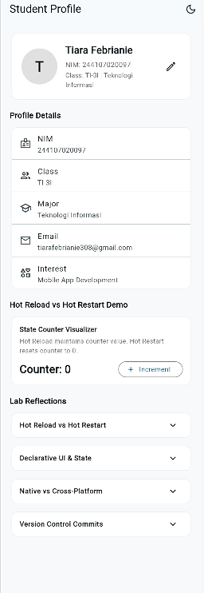

# Week 1: Mobile Development Ecosystem & Flutter Refresh

Mobile Application Development Lab Assignment - Week 1 Student Profile Application Report.

---

## Student Details
* **Name:** Tiara Febrianie
* **Student ID (NIM):** 244107020097
* **Class:** TI-3I
* **Department:** Information Technology - State Polytechnic of Malang (Polinema)

---

## Objectives
* Understand the mobile development ecosystem, comparing native, hybrid, and cross-platform approaches.
* Understand Flutter's architecture (framework, engine, embedder) and the role of Dart.
* Set up the development environment (Flutter SDK, Android SDK, VS Code) and verify with `flutter doctor`.
* Build and customize a simple Student Profile application in Flutter.
* Observe and understand the practical differences between Hot Reload and Hot Restart.
* Structure and maintain coursework progress using Git and GitHub.

---

## Tech Stack
* **Framework:** Flutter 3.x
* **Language:** Dart 3.x
* **Target Platform:** Android (Emulator / Physical Device), Windows Desktop, Web
* **Tools:** Visual Studio Code, Android Studio, Git

---

## Application Overview
This project is a Student Profile application built to fulfill Week 1 lab requirements and mini assignment. Key features include:
1. **Student Profile Card:** Displays Name, NIM, Class, Department, Email, and Hobbies with an interactive edit dialog.
2. **Dark & Light Theme:** Toggle switch to seamlessly swap between Dark Mode and Light Mode.
3. **Hot Reload vs Hot Restart Visualizer:** Interactive counter demonstrating state preservation during Hot Reload vs resetting state during Hot Restart.
4. **Lab Reflections Section:** In-app expandable cards displaying answers to Week 1 lab reflection questions.

---

## How to Run & Test

1. Navigate to the Week 1 project directory:
   ```bash
   cd 01-week-1-mobile-development-ecosystem-flutter-refresh
   ```
2. Get project dependencies:
   ```bash
   flutter pub get
   ```
3. Check available devices:
   ```bash
   flutter devices
   ```
4. Run the app on a connected device or emulator:
   ```bash
   flutter run
   ```
5. Run automated widget tests:
   ```bash
   flutter test
   ```

---

## Setup Problem & Solution

### Problem Encountered
When running commands like `flutter doctor` or `flutter create`, the terminal hung indefinitely without printing any error logs.

Upon checking, the issue was caused by locked `flutter.bat.lock` and `lockfile` files in the Flutter cache directory (`G:\Program Files\flutter\bin\cache\`). Because the Flutter SDK was installed inside `Program Files`, standard terminal processes running without administrator privileges were unable to delete or modify these lock files.

### Solution
1. Opened PowerShell as **Administrator**.
2. Force deleted the stuck lock files:
   ```powershell
   Remove-Item -Force "G:\Program Files\flutter\bin\cache\lockfile", "G:\Program Files\flutter\bin\cache\flutter.bat.lock"
   ```
3. Granted full modify permissions for the `Users` group on the Flutter folder so locks can be written and released cleanly:
   ```powershell
   icacls "G:\Program Files\flutter" /grant "Users:(OI)(CI)M" /T
   ```
After completing these steps, `flutter doctor` and `flutter run` executed smoothly without hanging.

---

## Hot Reload vs Hot Restart

* **Hot Reload (`r` in terminal):**
  * **Mechanism:** Injects updated code changes directly into the running Dart VM and re-runs the `build()` methods.
  * **State:** Preserves the current application state (for example, values entered in form dialogs or counter increments remain intact).
  * **Speed:** Extremely fast (sub-second). Ideal for fine-tuning UI layouts, paddings, and colors.

* **Hot Restart (`R` in terminal):**
  * **Mechanism:** Reloads the codebase into the Dart VM and restarts the app execution from `main()`.
  * **State:** Resets the application state back to its initial values.
  * **Speed:** Slightly slower (around 1–3 seconds). Required when modifying global state, static variables, `main()` configuration, or initializers.

---

## Lab Reflections

### 1. When is native development more appropriate than cross-platform development?

Cross-platform tools like Flutter are very convenient because we can write a single codebase for both Android and iOS, saving substantial development time. However, native development (using Kotlin/Java for Android and Swift/Objective-C for iOS) is still the better choice in specific situations:

First, when an app needs deep hardware integration or access to specific device features—such as custom Bluetooth peripherals, low-level sensors, or background services. Cross-platform plugins do not always support the newest OS APIs immediately when Apple or Google release new platform updates, and writing custom platform channels can sometimes take more effort than building native from the start.

Second, for applications that require maximum graphical performance, such as 3D gaming, complex animations, or real-time camera and video editing. Native code communicates directly with the OS graphics layer without the overhead of Flutter's rendering engine.

Lastly, when an app needs to follow platform-specific UI guidelines strictly (Material Design on Android and Cupertino on iOS) down to the smallest detail, or when adding features to an existing legacy native app where introducing a cross-platform framework would add unnecessary bundle size and architectural complexity.

### 2. How does a state change relate to the widget tree and declarative UI?

In traditional imperative UI (like native Android with XML), we usually grab a UI element by ID and manually update its properties—for example, calling `setText()` on a text view. Flutter works differently using a declarative approach: the UI is simply a visual representation of the current state of our data.

In this week's profile app, information like the student details and the counter are stored as state variables. Widgets in Flutter are immutable, meaning they cannot be modified once built. When data changes (for example, when we click the button to increment the counter or edit profile info), we call `setState()`. This tells Flutter that the underlying data has changed and that the UI needs to be updated.

When `setState()` runs, Flutter executes the `build()` method again to reconstruct the widget subtree with the updated state. Instead of redrawing everything from scratch on the screen, Flutter's engine compares the new widget tree with the previous one and only updates and repaints the specific widgets whose data actually changed.

### 3. Why are small commits with clear messages useful for teamwork and a portfolio?

From a teamwork perspective, making small, frequent commits that focus on a single logical task makes collaboration much smoother. When working with other developers, small commits mean smaller pull requests, which are easier to read and review. If a bug happens to be introduced, it is easy to locate the exact commit that caused the problem and revert it without breaking other features that were worked on at the same time. It also helps prevent large, painful merge conflicts when teammates edit overlapping files.

For a personal portfolio repository, commit history acts as a transparent log of our thought process and problem-solving habits. When an instructor or potential employer inspects the repository, having clear commits (like following conventional commits such as `feat:`, `fix:`, `docs:`) shows that we work methodically and build features step-by-step, rather than just writing everything in one go and making a single vague commit like "finish assignment".

---

## App Screenshot


