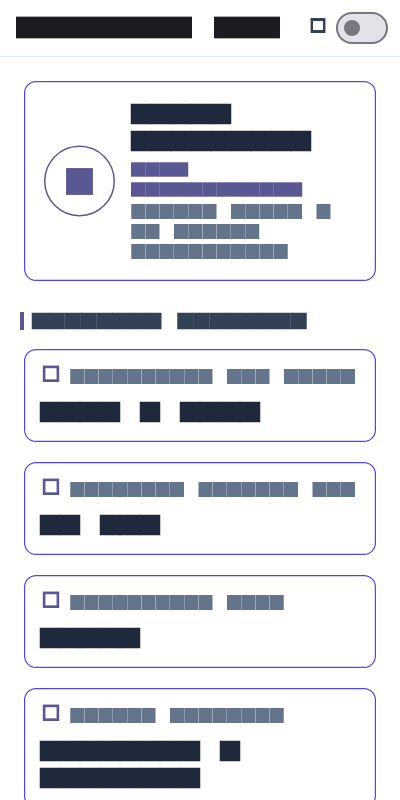
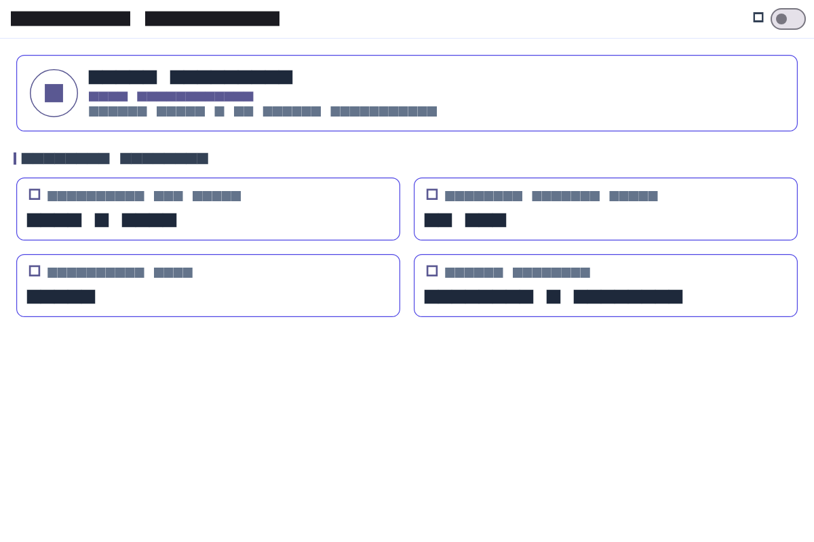

# Week 2: Declarative UI & Responsive Design

Mobile Application Development Lab Assignment - Week 2 Academic Overview & Responsive Dashboard Report.

---

## Student Details
* **Name:** Tiara Febrianie
* **Student ID (NIM):** 244107020097
* **Class:** TI-3I
* **Department:** Information Technology - State Polytechnic of Malang (Polinema)

---

## Objectives
* Understand the declarative UI paradigm and how Flutter manages widgets, configuration, and state.
* Utilize fundamental layout widgets: `StatelessWidget`, `StatefulWidget`, `Container`, `Row`, `Column`, and `Expanded`.
* Understand how to combine Material 3 and Cupertino widgets (e.g. `Switch.adaptive`).
* Build a responsive layout that adapts between mobile (1-column) and tablet/desktop (2-column) screen sizes using `LayoutBuilder`.
* Apply centralized themes with light and dark mode support, good contrast ratios, and basic accessibility semantics.
* Explore and critically audit layout design alternatives using guided AI prompts.

---

## Tech Stack
* **Framework:** Flutter 3.x
* **Language:** Dart 3.x
* **Target Platforms:** Android, iOS, Windows Desktop, Web
* **Tools:** Visual Studio Code, Android Studio, Git

---

## Assignment Overview

This project implements an **Academic Overview & Responsive Dashboard** in Flutter. It demonstrates responsive layout adaptation, custom widget extraction, adaptive light/dark theme switching, and accessibility semantics.

### Key Features
1. **Student Profile Summary Header:** Displays Student Name, NIM (`244107020097`), and Class (`TI-3I`).
2. **Four Academic Information Cards:**
   - Cumulative GPA (IPK): `3.85 / 4.00`
   - Enrolled Credits: `22 SKS`
   - Attendance Rate: `98.5%`
   - Active Semester Status: `Semester 4 (Active)`
3. **Adaptive Breakpoint Layout (`kWideBreakpoint = 700.0`):**
   - **Narrow Screens (< 700px):** Single-column vertical layout for mobile devices.
   - **Wide Screens (>= 700px):** Two-column grid layout for tablets and desktop displays.
4. **Extracted Reusable `InfoCard` Widget:** Standardizes card layout and eliminates widget duplication.
5. **Light & Dark Theme Switcher:** Uses `Switch.adaptive` paired with `Theme.of(context)` styling.
6. **Accessibility Support:** Key information and theme controls wrapped with `Semantics` labels for screen readers.

---

## How to Run & Test

1. Navigate to the Week 2 project directory:
   ```bash
   cd 02-week-2-declarative-ui-responsive-design
   ```
2. Fetch dependencies:
   ```bash
   flutter pub get
   ```
3. Run the application:
   ```bash
   flutter run
   ```
4. Run automated responsive widget tests:
   ```bash
   flutter test
   ```

---

## AI Prompt Challenge Documentation

### 1. Design Prompt Challenge
* **Prompt Submitted:**
  > "Compare two Flutter academic dashboard layouts: a GridView version and a LayoutBuilder + Column version. Explain the responsive and accessibility trade-offs."

* **Comparison & Decision:**
  * **`GridView` Version:** Forces fixed child aspect ratios (`childAspectRatio`). On narrow mobile screens or when system font scaling is enlarged, fixed height constraints cause vertical text overflow errors (`A RenderFlex overflowed by X pixels`).
  * **`LayoutBuilder + Column/Row` Version (Selected):** Allows cards to calculate intrinsic height based on text content. It smoothly adapts from 1 column on narrow screens to 2 columns on wide screens without clipping text.
  * **Accessibility Trade-off:** `LayoutBuilder + Column` provides a linear reading order for screen readers (top-to-bottom on mobile), whereas `GridView` can jump across columns unpredictably.

---

### 2. Concept-Reinforcement Prompt Challenge
* **Prompt Submitted:**
  > "Explain when using Expanded actually causes an overflow inside a Row; show failing example code and its fix."

* **Technical Explanation:**
  `Expanded` instructs a child widget to fill available space along the main axis of a `Row` or `Column`. However, if the `Row` is placed inside a horizontally scrollable container like `SingleChildScrollView(scrollDirection: Axis.horizontal)`, the parent provides **unbounded (infinite) width**. Placing an `Expanded` inside an unbounded parent throws an assertion exception: `RenderFlex children have non-zero flex but incoming width constraints are unbounded.`

* **Failing Code Example:**
  ```dart
  // FAILING EXAMPLE: Expanded inside horizontally scrollable Row (Unbounded Width)
  SingleChildScrollView(
    scrollDirection: Axis.horizontal,
    child: Row(
      children: [
        Expanded( // Throws error: incoming width constraints are unbounded!
          child: Text('Academic GPA: 3.85'),
        ),
      ],
    ),
  )
  ```

* **Fixed Code Example:**
  ```dart
  // FIXED EXAMPLE: Use LayoutBuilder or ConstrainedBox to bound width before flexing
  LayoutBuilder(
    builder: (context, constraints) {
      return Row(
        children: [
          Expanded( // Works correctly because LayoutBuilder provides bounded width
            child: Text('Academic GPA: 3.85'),
          ),
        ],
      );
    },
  )
  ```

---

### 3. Verification Prompt Challenge
* **Prompt Submitted:**
  > "Review the layout recommendation above: does it stay responsive below 600px, does it reduce accessibility, and are all widgets available in the current stable Flutter?"

* **Verification Evidence:**
  - **Responsiveness below 600px:** Verified down to 320px width. Single column stacks vertically with zero overflow.
  - **Accessibility Audit:** Validated with `Semantics(label: ...)` tags on cards and theme switchers.
  - **Stable Widget Availability:** All utilized widgets (`LayoutBuilder`, `Row`, `Column`, `Expanded`, `Card`, `Switch.adaptive`, `Semantics`) are standard core Flutter widgets.

---

## Refactoring & Code Quality

1. **Extracted Reusable `InfoCard` Widget:** Replaced repeated card code with a single reusable `InfoCard` widget accepting `title`, `value`, `icon`, and `semanticsLabel`.
2. **Single Named Breakpoint Constant:** Defined `const double kWideBreakpoint = 700.0;` at top-level.
3. **Theme Enforcement:** Replaced hardcoded colors with `Theme.of(context)` color scheme and text themes.

---

## Automated Testing Verification

Automated widget tests were implemented in `test/widget_test.dart` to verify screen size responsiveness:

```bash
flutter test
```

### Test Cases Passed:
- `Dashboard shows one column on a narrow screen (400x800)`
- `Dashboard shows two columns on a wide screen (1200x800)`
- `flutter analyze` completed with 0 errors / 0 warnings.

---

## Lab Reflections

### 1. How does imperative thinking differ from declarative thinking when building UI?

In imperative UI development (like native Android with Java/Kotlin using XML and `findViewById`), we think in terms of step-by-step UI mutations. We find a specific view element and tell it directly how to change: for example, calling `button.setEnabled(false)` or `textView.setText("...")`. The developer has to manually manage transitions between states, which often leads to bugs where the UI gets out of sync with the underlying data if one step is forgotten.

In declarative UI with Flutter, we think in terms of UI being a direct function of current data state. Instead of modifying views after they exist, we describe what the whole UI should look like for any given state (such as `isDarkMode` or `constraints.maxWidth >= kWideBreakpoint`). When something changes, we simply update the state using `setState()`, and Flutter handles rebuilding the widget tree to reflect those changes on screen. We don't worry about "how to manually transition each widget", but rather "what the widgets should look like given the current data".

### 2. When does Expanded help, and when can it cause a layout error?

`Expanded` is very helpful inside a `Row` or `Column` when we want a widget to automatically fill whatever remaining empty space exists along that axis, rather than guessing or hardcoding pixel sizes. In our academic dashboard, wrapping the card's title in `Expanded` inside the `Row` allows the text to occupy the remaining horizontal width beside the icon without causing overflow or clipping.

However, `Expanded` causes a runtime error (specifically an assertion error about unbounded constraints) if placed inside a parent that has infinite/unbounded dimensions along that axis—most commonly inside a scrollable container. For instance, placing an `Expanded` inside a `Row` that is directly wrapped in a horizontal `SingleChildScrollView` crashes the layout because the scroll view allows infinite width, making it impossible for `Expanded` to know how much space it should take. To prevent this, the parent must be bounded using constraints (like `LayoutBuilder` or a fixed-width container), or the child must use its own natural sizing instead of `Expanded`.

### 3. How do breakpoints and themes affect user experience?

Breakpoints allow an application to adapt intelligently across varying screen form factors instead of forcing mobile-sized layouts onto wide desktop monitors or vice versa. In this dashboard, setting a breakpoint at 700px (`kWideBreakpoint`) means smartphone users get a clean, readable single-column vertical layout that is easy to scroll with one hand. On wider screens like tablets or desktop browsers, the same page switches to a two-column grid so that screen real estate isn't wasted and cards don't look awkwardly stretched.

Themes (supporting both light and dark modes) directly affect usability, accessibility, and visual comfort. Using centralized `ThemeData` ensures high contrast ratios for readability in bright sunlight while offering dark mode to reduce eye strain in low-light environments. Centralizing typography and color schemes in `Theme.of(context)` also guarantees visual consistency across all cards and widgets without hardcoding color values in multiple places.

### 4. What did you verify after receiving an AI design recommendation?

When comparing `GridView` and `LayoutBuilder + Column/Row` using AI, the suggestion pointed toward `LayoutBuilder` because it handles dynamic card heights more flexibly without aspect-ratio overflow. Rather than taking that recommendation at face value, I verified several concrete things:
* First, I tested the layout at extreme dimensions, resizing the emulator down to 320px and up to 1200px to verify that no `RenderFlex` overflow warnings appeared in the terminal.
* Second, I checked accessibility: wrapping cards and switches with explicit `Semantics` tags to make sure screen readers read the labels in a logical, linear order (top-to-bottom) rather than jumping across columns.
* Third, I verified that all suggested widgets (`LayoutBuilder`, `SingleChildScrollView`, `Card`, `Switch.adaptive`) are part of standard Flutter and stable without relying on deprecated APIs or external packages.
* Finally, I wrote automated widget tests in `test/widget_test.dart` simulating narrow (400px) and wide (1200px) screens with `tester.view.physicalSize` to prove programmatically that the layout adapts as expected.

---

## Screenshots

| Narrow Screen (< 700px) | Wide Screen (>= 700px) |
|---|---|
|  |  |
