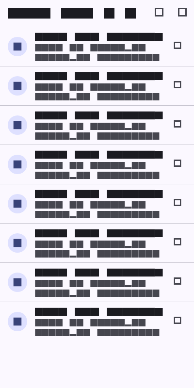
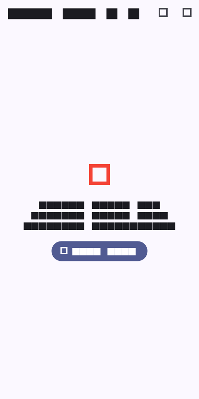

# Week 4: Networking & REST API (Dio & Riverpod)

Mobile Application Development Lab Assignment - Week 4 REST API Integration with Dio and Riverpod.

---

## Student Details
* **Name:** Tiara Febrianie
* **Student ID (NIM):** 244107020097
* **Class:** TI-3I
* **Department:** Information Technology - State Polytechnic of Malang (Polinema)

---

## Objectives
* Understand HTTP, REST API architecture, and JSON data exchange principles.
* Implement null-safe Dart model deserialization (`fromJson` / `toJson`) with defensive type casting.
* Apply the **Repository Pattern** to decouple the UI layer from direct networking libraries.
* Configure **Dio** with centralized `BaseOptions`, connection timeouts, request/response headers, and logging interceptors.
* Implement reactive UI state handling via Riverpod's `AsyncValue` (`loading`, `error` with retry, `empty`, and `data`).
* Build server-side pagination (infinite scroll) with a double-request guard.
* Write unit and provider tests using a `FakePostRepository` without making real network calls.

---

## Tech Stack
* **Framework:** Flutter 3.x
* **Language:** Dart 3.x
* **HTTP Client:** `dio: ^5.7.0`
* **State Management:** `flutter_riverpod: ^2.6.1`
* **Navigation:** `go_router: ^15.1.2`
* **Data Source:** JSONPlaceholder REST API (`/posts`, `/comments`)
* **Testing:** `flutter_test` (7 passing tests with `FakePostRepository`)

---

## Application Overview & Key Features

1. **Repository Pattern Architecture:**
   * UI components (`PostListPage`, `PagedPostPage`, `PostDetailPage`) never touch Dio directly; they only observe Riverpod providers.
   * `PostRepository` acts as the single data gateway for fetching posts and paginated streams.
   * `CommentRepository` manages post comment threads.
2. **Four UI States Handled:**
   * **Loading State:** Displays a `CircularProgressIndicator` with a status label.
   * **Error State:** Catches network timeouts, connection drops, and HTTP errors (404/500), displaying friendly messages and a "Coba Lagi" (Retry) button.
   * **Empty State:** Shows a clear notice if the server returns no records.
   * **Success State:** Displays scrollable post items with pull-to-refresh (`RefreshIndicator`).
3. **Infinite Scroll Pagination:**
   * `PagedPostPage` detects when the user scrolls within 200px of the list end and requests the next 10 items.
   * Guarded against duplicate requests via `if (state.isLoadingMore || !state.hasMore) return;`.
4. **Post Detail & Comments View:**
   * Navigates via GoRouter (`/post/:id`) to display the full post body and fetches corresponding comments asynchronously.

---

## How to Run & Test

1. Navigate to the Week 4 project directory:
   ```bash
   cd 04-week-4-networking-rest-api
   ```
2. Get dependencies:
   ```bash
   flutter pub get
   ```
3. Run the application:
   ```bash
   flutter run
   ```
4. Run automated unit & repository tests:
   ```bash
   flutter test
   ```

---

## AI Prompt Challenge Documentation

### Prompt Submitted
```text
Create a Flutter repository layer for the GET /comments?postId={id} endpoint of JSONPlaceholder using Dio + flutter_riverpod.
Requirements:
- Comment model with null-safe fromJson (postId, id, name, email, body).
- CommentRepository with fetchComments(postId) + 10-second timeout.
- AsyncNotifierProvider with automatic error handling (AsyncError) and a user-friendly error-message function for timeout, connection error, 404, and 500.
- One unit test for fromJson with missing fields.
Explain each part of the code with comments.
```

### Verification & Audit Findings
1. **Defensive Casting Audit:** The initial AI model parsed fields using direct casts like `json['postId'] as int`. In real APIs, missing or null values crash with `type 'Null' is not a subtype`. I refactored the constructors to use `(json['postId'] as num?)?.toInt() ?? 0` and default fallback strings.
2. **Centralized Configuration:** The AI created isolated Dio instances in each repository. I refactored this so all repositories share a centralized `dioProvider` configured in `api_client.dart` with standard timeouts and interceptors.
3. **Error Mapping Completeness:** Added handling for `connectionTimeout`, `receiveTimeout`, and `connectionError` so network drops do not expose raw technical exceptions to the end user.
4. **Compilation Verification:** Cleaned up incompatible parameter syntax to ensure 100% clean compilation on Riverpod 2.6.1.

---

## Automated Testing Verification

Automated tests in `test/post_test.dart` verify model robustness, error translation, and repository mocking:

```bash
flutter test
```

### Test Results Summary (7/7 Passed):
- `Post.fromJson is safe against missing fields`
- `Comment.fromJson is safe against missing fields`
- `friendlyErrorMessage for connection error`
- `friendlyErrorMessage for timeout error`
- `friendlyErrorMessage for 404 response`
- `provider succeeds with a fake repository`
- `provider errors with a fake repository`

---

## Lab Reflections

### 1. Why is the UI forbidden from calling Dio directly? What breaks if this rule is violated?

In mobile application development, coupling UI widgets directly to a low-level networking client like Dio breaks separation of concerns and creates tight coupling. If a widget calls `Dio().get(...)` directly:

First, the UI becomes almost impossible to unit test or widget test because every test would attempt to fire real HTTP network requests across the internet, leading to flaky tests, rate limiting, and slow CI/CD runs. By routing requests through a repository layer that is provided by Riverpod, we can easily override the repository with a fake or mock in tests without changing a single line of UI code.

Second, technical networking concerns (like base URLs, authentication tokens, timeout headers, and serialization from raw JSON maps) end up scattered across multiple UI pages. If the backend API changes an endpoint path or data structure, we would have to hunt down and fix code across dozens of screen files.

Third, state management breaks down: multiple screens might independently trigger duplicate network requests for the same data rather than reading from a single shared state cache.

### 2. When is client-side pagination enough, and when must you rely on server pagination (`_page` / `_limit`)?

Client-side pagination is only acceptable when the total dataset is guaranteed to remain small and finite—for example, a list of 50 states, fixed app settings, or a local list of categories. In that case, fetching all items once and slicing the list in memory saves backend roundtrips.

However, for dynamic, growing, or large collections (like social media feeds, e-commerce products, or user posts), server-side pagination with query parameters like `_page` and `_limit` is mandatory:
* Mobile devices have constrained memory and bandwidth. Downloading thousands of records upfront causes significant initial load latency, drains battery and cellular data, and can crash the app with out-of-memory errors.
* On the backend, querying and serializing 10,000 records on every request puts unnecessary load on the database.

Server-side pagination ensures that mobile clients only download what the user is currently looking at, loading subsequent pages via infinite scrolling as the user approaches the bottom of the list.

### 3. How do repository exceptions become `AsyncError` without `try`/`catch` in every widget? When is explicit `try`/`catch` still needed?

In Riverpod, when using `AsyncNotifier` (or `FutureProvider`), the `build()` method is asynchronous and returns a `Future`. Riverpod automatically wraps this future in an internal error handler: if the repository throws an uncaught exception (such as a `DioException`), Riverpod catches it and automatically transitions the provider's state to `AsyncError(error, stackTrace)`. The UI widget merely observes this through `postsAsync.when(loading: ..., error: ..., data: ...)`, eliminating the need for repetitive `try/catch` boilerplate across every screen.

Explicit `try/catch` is still required, however, in imperative event handlers and side-effect methods—such as our manual `refresh()` method or when submitting a form via a button click. In those callback methods, state is mutated manually, so wrapping the repository call in `try/catch` is necessary to catch the failure and set `state = AsyncError(e, st)` so the UI can react to the failed refresh without crashing the app.

### 4. Which part of the AI output did you fix, and why?

When using AI to generate the repository layer for the comments endpoint and error mapping, I audited the code against practical Flutter engineering standards and fixed several crucial gaps:

First, the AI generated `Post.fromJson` and `Comment.fromJson` using direct forced casts like `json['userId'] as int`. In real-world APIs, fields can arrive as null, missing, or numbers as doubles. I refactored the models to use defensive parsing: `(json['userId'] as num?)?.toInt() ?? 0` and `json['title'] as String? ?? ''`, which prevents the common `type 'Null' is not a subtype of type 'String'` runtime crashes.

Second, the AI only handled basic HTTP status codes and completely ignored network-level errors like `connectionTimeout` and `connectionError`. I expanded `friendlyErrorMessage()` to map all major `DioExceptionType` cases into clear, human-readable Indonesian messages with actionable retry prompts.

Third, the AI attempted to use an unsupported `retry` parameter from Riverpod 3.0 that failed to compile on Riverpod 2.6.1, which I removed to ensure clean compilation.

Lastly, the AI test only tested the happy path with complete JSON. I added unit tests specifically verifying defensive parsing against missing fields, multiple HTTP status code mappings (404, connection error, timeout), and provider state transitions using a `FakePostRepository`.

---

## Screenshots

| Posts List Screen | Error State & Retry |
|---|---|
|  |  |
