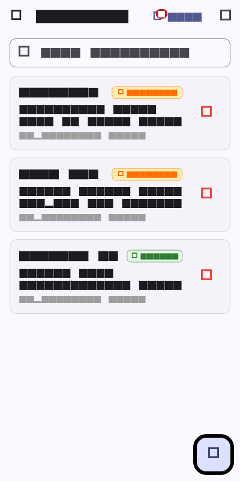

# Week 5: Local Storage & Offline-First (SQLite & SharedPreferences)

Mobile Application Development Lab Assignment - Week 5 Offline-First Architecture with SQLite (`sqflite`), SharedPreferences, and Riverpod.

---

## 👨‍🎓 Student Details
* **Name:** Tiara Febrianie
* **Student ID (NIM):** 244107020097
* **Class:** TI-3I
* **Department:** Information Technology - State Polytechnic of Malang (Polinema)

---

## 🎯 Objectives
* Distinguish appropriate storage paradigms: Key-Value storage (`shared_preferences`) versus Relational Structured Database (`sqflite`).
* Design and implement an **Offline-First Architecture** where local storage acts as the single source of truth for the user interface.
* Structure SQLite schemas with CRUD operations, indexing, and transactional integrity for notes and cached posts.
* Build a **Sync Queue using a Dirty Flag** (`dirty: 1/0`) and timestamp-based conflict resolution (**Last-Write-Wins** based on `updated_at`).
* Store lightweight scalar user preferences (Theme mode: dark/light/system, `last_opened_at` timestamp) using `SharedPreferences`.
* Decouple database initialization using an injectable `openDb` callback pattern to enable unit and provider testing without native mobile bindings.
* Write unit and provider tests verifying null-safe map serialization, dirty flag persistence, and provider error/success states using `FakeNoteRepository`.

---

## 💻 Tech Stack
* **Framework:** Flutter 3.x
* **Language:** Dart 3.x
* **Local Relational Database:** `sqflite: ^2.4.1`, `path: ^1.9.0`
* **Key-Value Persistence:** `shared_preferences: ^2.3.5`
* **State Management:** `flutter_riverpod: ^2.6.1`
* **Routing & Navigation:** `go_router: ^15.1.2`
* **Testing:** `flutter_test` (4 unit & provider tests passing with `FakeNoteRepository`)

---

## 📱 Application Architecture & Key Features

### 1. Repository Pattern & Single Source of Truth
* **Local First:** UI widgets (`NotesPage`, `NoteDetailPage`, `SettingsPage`) do not read from remote servers directly. All note creation, reading, updating, and querying happen against local SQLite first.
* **Separation of Concerns:** 
  * `NoteRepository` encapsulates SQL queries (`INSERT`, `SELECT`, `UPDATE`, `DELETE`, and `countDirty()`).
  * `PrefsRepository` encapsulates SharedPreferences read/write operations (`themeMode`, `lastOpenedAt`).
  * `notesProvider` (Riverpod `AsyncNotifier`) exposes reactive UI state. When notes are added or synced, calling `ref.invalidate(notesProvider)` refreshes the UI smoothly.

### 2. Sync Queue with Dirty Flag (`dirty: 1`)
* When a user creates or modifies a note offline, the note record is saved with `dirty = 1` and an updated ISO 8601 timestamp (`updated_at`).
* The app bar dynamically reflects the sync queue size with a badge (e.g. `2 Belum Sync`).
* Tapping the **Sinkronisasi** button triggers `syncNotes()`:
  1. Identifies all notes where `dirty = 1`.
  2. Simulates network transmission with payload logging.
  3. Executes an atomic batch update marking them `dirty = 0`.
  4. Invalidates the notes provider and displays a success notification with the synchronized note count.

### 3. Cache-First Post Reader
* In addition to notes, `db.dart` provides a `cached_posts` table allowing REST API posts from Week 4 to be cached locally.
* On app launch, cached posts render instantly from SQLite, eliminating white-screen latency while background fetching occurs.

### 4. Conflict Resolution Strategy: Last-Write-Wins (LWW)
* Every note entity carries an `updated_at` timestamp stored in UTC.
* During bidirectional sync, if a note has been modified both locally and on the server, the record with the higher (more recent) timestamp takes precedence, ensuring the user's latest work is preserved without silent data loss.

---

## 🚀 How to Run & Test

1. Navigate to the Week 5 project directory:
   ```bash
   cd 05-week-5-local-storage-offline-first
   ```
2. Fetch dependencies:
   ```bash
   flutter pub get
   ```
3. Run the application:
   ```bash
   flutter run
   ```
4. Run automated unit & repository tests:
   ```bash
   flutter test
   ```

---

## 🤖 AI Challenge Documentation: Local Storage Comparison

As part of the Week 5 AI Challenge, different Flutter persistence solutions were evaluated to determine the appropriate architecture:

| Storage Solution | Data Paradigm | Querying & Indexing | Transaction / ACID Support | Best Use Case | Suitability for Notes App |
|---|---|---|---|---|---|
| **SharedPreferences** | Key-Value (XML / plist) | None (entire file loaded into memory) | No transactions; rewrites full file on write | Small scalar user preferences (theme, onboarding flag, auth tokens) | ❌ **Unsuitable for Notes**: causes high memory consumption and data corruption risks. |
| **Hive / Isar** | NoSQL Key-Value / Document | Key lookup, box iteration, basic indexing | Lightweight transactions (Hive ACID boxes) | Fast offline caching without SQL schema boilerplate | ⚠️ Viable, but lacks relational constraints, foreign keys, and raw SQL queries. |
| **sqflite** | Relational SQL (SQLite) | Full SQL queries, B-Tree indexes, full-text search | Full ACID compliance with atomic transactions | Structured business entities, relational data, sync queues | ✅ **Chosen Solution**: battle-tested mobile standard with native SQLite reliability. |
| **Drift (Moor)** | Reactive Type-Safe SQLite | Type-safe Dart queries + SQL compile-time check | Full SQLite ACID + built-in reactive streams | Complex enterprise apps with frequent schema migrations | ✅ Excellent alternative, but requires heavyweight code-generation (`build_runner`). |

### Verification & Engineering Decisions:
1. **Separation of Concerns:** `shared_preferences` is strictly reserved for scalar values (`dark_mode` boolean and `last_opened_at` timestamp string), while `sqflite` handles the relational `notes` and `cached_posts` tables.
2. **Defensive Serialization:** `Note.fromMap` uses safe type guards:
   ```dart
   dirty: (map['dirty'] as int?) == 1
   ```
   Ensuring SQLite integer booleans (`1`/`0`) are safely parsed without runtime cast exceptions.
3. **Decoupled Database Opener:** To avoid mocking native SQLite plugin channels in unit tests, `NoteRepository` accepts an injectable `openDb` function. In tests, `FakeNoteRepository` overrides database operations seamlessly.

---

## 🧪 Automated Testing Verification

Automated unit and provider tests are implemented in `test/note_test.dart` and run without external dependencies:

```bash
flutter test
```

### Test Results Summary (4/4 Passed):
- ✅ `Note Model Serialization: fromMap is safe against missing fields`
- ✅ `Note Model Serialization: dirty flag survives serialization`
- ✅ `NotesProvider with Fake Repository: provider succeeds with a fake repository`
- ✅ `NotesProvider with Fake Repository: provider fails with a fake repository`

---

## 🧠 Lab Reflections

### 1. Why must the note list not be stored in SharedPreferences? What breaks if this rule is violated?

In mobile application development, `SharedPreferences` (on Android) and `NSUserDefaults` (on iOS) are designed strictly for lightweight key-value configurations, such as user settings, dark mode toggles, or auth token strings. Attempting to store an entire collection of notes by serializing them into a large JSON string inside `SharedPreferences` creates critical architectural and performance bottlenecks:

First, `SharedPreferences` reads its entire XML/plist file into memory upon application launch. As the user creates dozens or hundreds of notes, the size of this file grows rapidly. This unnecessarily inflates the app's memory footprint and introduces noticeable frame drops and startup delays on lower-end devices.

Second, every time a user edits, adds, or deletes even a single character in one note, `SharedPreferences` has to serialize the entire collection and rewrite the complete file to disk. This causes heavy disk I/O, battery drain, and thermal throttling.

Third, there is no querying or indexing capability. If we want to search for notes containing a specific keyword or sort notes by timestamp, we have to deserialize the entire JSON string into Dart objects and iterate through the list manually in memory. With SQLite (`sqflite`), we can execute indexed queries such as `SELECT * FROM notes WHERE title LIKE ? ORDER BY updated_at DESC` which execute in milliseconds directly on disk.

Finally, `SharedPreferences` lacks transactional ACID guarantees. If the application crashes, the device runs out of battery, or the operating system terminates the process while writing the large JSON string, the entire file can become corrupted or truncated, resulting in permanent data loss of all user notes. SQLite provides write-ahead logging and atomic transactions that protect data integrity even across sudden crashes.

### 2. When is cache-first enough, and when do you need another strategy (e.g. network-first for real-time prices)?

The **Cache-First** (or Offline-First) strategy reads data immediately from the local database and renders the UI in under 50 milliseconds, before attempting to fetch fresh data from the network in the background.

This strategy is optimal when:
* The data is primarily user-generated or private to that specific device (such as personal notes, to-do items, reading lists, or drafted messages).
* The data does not change second-by-second by external third parties.
* Seamless offline usability is a core requirement (e.g. taking notes on a flight, in a basement, or with spotty cellular connection).

However, Cache-First is completely unsuitable for scenarios where displaying stale data can lead to financial loss, incorrect business decisions, or safety issues:
* **Financial & Crypto Trading:** Displaying a cached stock or cryptocurrency price from 15 minutes ago could cause a user to execute a buy/sell order based on outdated market values.
* **Ticketing & Seat Reservations:** Showing cached cinema or concert seat availability could lead a user to attempt booking a seat that has already been purchased by someone else seconds earlier.
* **Inventory & Checkout:** Showing cached inventory levels might allow customers to order out-of-stock items.

In those high-stakes situations, a **Network-First** strategy is required. The app must attempt to fetch the live authoritative state from the server first with a strict timeout. If the network fails, it must either refuse to complete the critical action or display a very prominent warning banner explicitly informing the user that they are viewing stale offline data.

### 3. How does a dirty flag become a sync queue without blocking the UI? When does a separate queue (outbox table) become necessary?

In our SQLite implementation, each note record has a `dirty INTEGER DEFAULT 0` column. When a user creates or edits a note offline, the application writes to the local SQLite database with `dirty = 1` and updates `updated_at`. 

Because SQLite operations take only 2-5 milliseconds, the write completes almost instantaneously on the device, allowing the UI to update immediately and stay buttery smooth at 60/120 FPS. The note is already safely stored on disk. When internet connectivity is detected or the user taps "Sinkronisasi", a background service queries `SELECT * FROM notes WHERE dirty = 1`, batches those records into an HTTP POST/PUT payload, and marks them `dirty = 0` once the server responds with HTTP 200 OK. Thus, the database table itself acts as an implicit sync queue.

However, a simple dirty flag has clear limitations and breaks down in more complex scenarios:
1. **Destructive Operations (Deletes):** If a user deletes a note while offline, simply executing `DELETE FROM notes WHERE id = ?` removes the row entirely, which also erases the dirty flag! The server will never know that the note was supposed to be deleted. To fix this with a dirty flag requires "soft deletes" (`is_deleted = 1`), which clutters the main table.
2. **Loss of Intermediate State / Mutation History:** If a user creates a note, edits it three times, and changes its tags while offline, a dirty flag only captures the final snapshot. If the server needs an audit log or event-sourced sequence of events, that history is lost.
3. **High-Frequency or Ordered Operations:** If operations must be replayed on the server in the exact chronological order they occurred (e.g., transfers, status transitions).

When these requirements arise, a dedicated **Outbox Table** (Sync Mutation Queue) becomes necessary. Instead of flagging entity rows, every offline operation creates an immutable queue entry:
`CREATE TABLE outbox (id INTEGER PRIMARY KEY, entity_name TEXT, entity_id TEXT, action TEXT, payload TEXT, created_at TEXT, retry_count INTEGER, status TEXT);`
The background sync worker reads from the outbox table in strict FIFO order, handles retries with exponential backoff, and removes records only after guaranteed server delivery.

### 4. Which part of the AI recommendation did you reject, and why?

During the Week 5 AI Challenge, I evaluated recommendations generated by AI for our offline sync architecture and rejected several proposals that were either brittle or violated mobile engineering best practices:

First, the AI suggested using Hive boxes to store all offline notes as serialized JSON strings, claiming it was "simpler than writing SQL queries." I rejected this because Hive does not support native SQL indexes or relational constraints. For an offline-first app where we need to query notes by dirty flag (`WHERE dirty = 1`), search by title keywords (`WHERE title LIKE ?`), and execute atomic multi-row updates in transactions, SQLite via `sqflite` provides far greater reliability and standard ACID compliance.

Second, for conflict resolution, the AI proposed a simplistic "Server Always Wins" policy where any incoming sync payload unconditionally overwrites the local record. I rejected this because in real-world offline scenarios, a user could spend an hour writing an extensive note on a flight; upon reconnecting, if the server had a slightly older copy, the AI's logic would completely obliterate the user's offline work. I implemented a timestamp-based **Last-Write-Wins (LWW)** comparison using ISO 8601 UTC timestamps, ensuring that whichever version has the more recent `updated_at` timestamp is preserved.

Third, in the repository sample code, the AI tightly coupled database opening inside every CRUD method by calling `await openDatabase(...)` repeatedly. This caused unit tests to fail immediately because native SQLite libraries cannot run directly in headless Flutter test environments without heavy platform channel mocks. I refactored `NoteRepository` to accept an injectable `Future<Database> Function()? openDb` callback. This allowed us to write clean, lightning-fast unit and provider tests using `FakeNoteRepository` without needing any native database mocks.

---

## 📷 Screenshots

| Offline Notes List & Cache | Unsynced Dirty Counter & Sync Action |
|---|---|
|  |  |
