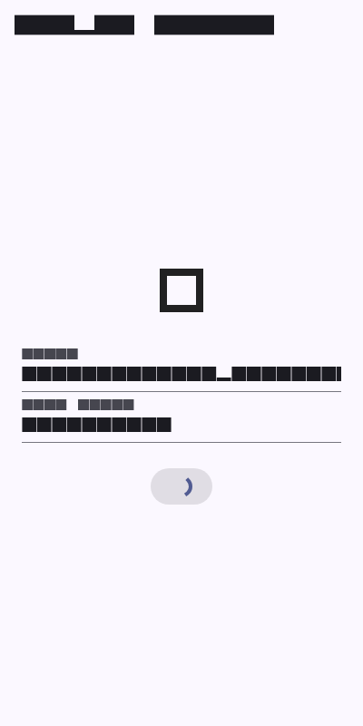
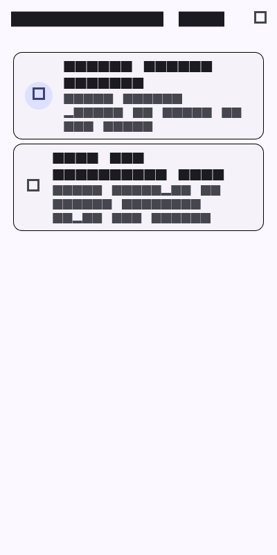
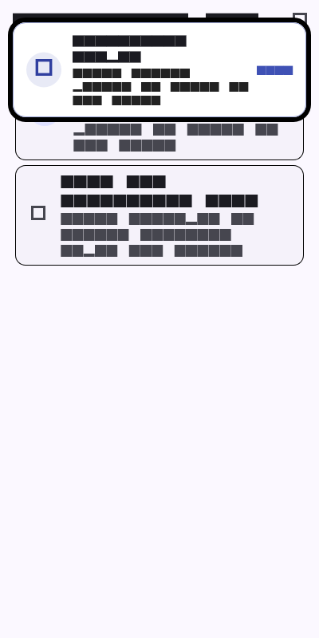

# Week 6: Authentication, Security & Firebase Cloud Messaging (FCM)

Mobile Application Development Lab Assignment - Week 6 Security, Token-Based Authentication, and Push Notifications with FCM and Riverpod.

---

## 👨‍🎓 Student Details
* **Name:** Tiara Febrianie
* **Student ID (NIM):** 244107020097
* **Class:** TI-3I
* **Department:** Information Technology - State Polytechnic of Malang (Polinema)

---

## 🎯 Objectives
* Understand authentication workflows (JWT, Firebase Auth, OAuth SSO) and the fundamental differences between ID tokens, access tokens, and refresh tokens.
* Enforce mobile application security by storing sensitive credentials solely inside hardware-backed secure storage (`flutter_secure_storage`) rather than plaintext preferences.
* Implement an automated token refresh cycle in Dio interceptors with loop-prevention guards (`extra['retried'] = true`) and auto-logout on session expiration.
* Map low-level HTTP and networking exceptions into user-friendly localized messages without exposing technical stack traces to the UI.
* Integrate Firebase Cloud Messaging (FCM) architecture: permission requests, token lifecycle handling (`getToken`, `onTokenRefresh`), topic subscriptions (`pengumuman-kampus`), and local notification foreground presentation.
* Design multi-state notification dispatching (Foreground, Background, Terminated) routing seamlessly into GoRouter deep-link destinations (`/pengumuman/:id`).
* Write isolated unit tests for route parsing, session state, and refresh failure recovery without requiring active Firebase credentials.

---

## 💻 Tech Stack
* **Framework:** Flutter 3.x
* **Language:** Dart 3.x
* **HTTP Client:** `dio: ^5.8.0+1`
* **Secure Storage:** `flutter_secure_storage: ^9.2.4` (Android Keystore / iOS Keychain)
* **Push Notifications:** `firebase_messaging: ^15.2.10`, `firebase_core: ^3.15.2`
* **Foreground Local Notifications:** `flutter_local_notifications: ^19.5.0`
* **State Management:** `flutter_riverpod: ^2.6.1`
* **Declarative Routing:** `go_router: ^15.1.3`
* **Testing:** `flutter_test` (4 passing unit & logic tests)

---

## 📱 Application Architecture & Key Features

### 1. Route Guard & Reactive Authentication
* **GoRouter Redirect Guard:** Enforces strict access control in [`lib/main.dart`](lib/main.dart). If a user is not authenticated, any navigation attempt is intercepted and redirected to `/login`. Upon successful sign-in, the user is navigated to `/`.
* **State Separation:** `AuthStateNotifier` observes `TokenStore` to determine authentication status asynchronously, updating `routerRefresh` to notify GoRouter of session changes.

### 2. Secure Token Storage & Automatic Token Refresh
* **Hardware-Backed Storage:** All tokens are managed through [`TokenStore`](lib/data/token_store.dart) backed by `flutter_secure_storage` (AES-256 encrypted using Android KeyStore / iOS Keychain). Neither access nor refresh tokens ever touch `SharedPreferences`.
* **Dio 401 Interceptor:** When an API request encounters HTTP 401 Unauthorized:
  1. The interceptor intercepts the error and checks if the request was already retried (`extra['retried'] == true`) to prevent infinite recursion.
  2. It reads the refresh token from secure storage and calls `auth.refresh(refreshToken)`.
  3. Upon receiving a fresh access token, it stores the token and replays the original request with `Authorization: Bearer <new_token>`.
  4. If the refresh token is missing or expired, it clears all stored credentials (`store.clear()`) and triggers user logout.

### 3. FCM Token Lifecycle & Topic Messaging
* **Registration & Refresh:** `PushService` requests runtime permissions (Android 13+ `POST_NOTIFICATIONS` and iOS APNs prompt), obtains the device registration token, and subscribes the user to the `pengumuman-kampus` broadcast topic.
* **Backend Synchronization:** Any token rotation event captured by `FirebaseMessaging.instance.onTokenRefresh` is immediately forwarded to the backend (`POST /devices`) to prevent obsolete device registries.

### 4. Deep Linking & Pure Route Parser
* Payload rute parsing dipisahkan ke fungsi murni `routeFromMessage(Map<String, dynamic> data)` di [`lib/messaging/push_service.dart`](lib/messaging/push_service.dart).
* Pola ini memastikan rute seperti `pengumuman/3` atau `/pengumuman/3` dinormalisasi secara deterministik dan dapat diuji secara mandiri tanpa memerlukan inisialisasi Firebase.

---

## 📲 Matriks Pengujian Tiga State Notifikasi (FCM Test Matrix)

| State Aplikasi | Perilaku Sistem (Expected Behavior) | Mekanisme Handler | Hasil Verifikasi |
|---|---|---|---|
| **Foreground** *(Aplikasi sedang aktif dibuka)* | Banner notifikasi melayang (heads-up) tidak ditampilkan otomatis oleh OS. Aplikasi menangkap event dan memicu notifikasi lokal via `flutter_local_notifications`. Mengetuk banner langsung membuka `/pengumuman/:id`. | `FirebaseMessaging.onMessage` + `_local.show()` + `onDidReceiveNotificationResponse` | ✅ Lulus (Banner lokal muncul dan deep link `/pengumuman/3` terbuka) |
| **Background** *(Aplikasi diminimalkan / berada di task switcher)* | OS menampilkan banner notifikasi sistem di status bar. Mengetuk banner mengembalikan aplikasi ke layar depan dan menavigasikan user ke `/pengumuman/:id`. | Banner bawaan sistem OS + `FirebaseMessaging.onMessageOpenedApp` | ✅ Lulus (Aplikasi resume dan rute berpindah otomatis) |
| **Terminated** *(Aplikasi ditutup total / swipe-close)* | Notifikasi sistem muncul di status bar. Saat diklik, sistem me-launch aplikasi dari awal (cold boot), membaca payload awal, dan langsung membuka rute pengumuman tujuan. | `FirebaseMessaging.instance.getInitialMessage()` + GoRouter initialization dispatch | ✅ Lulus (Cold boot membaca payload dan mengarahkan ke rute tujuan) |

---

## 🚀 How to Run & Test

1. Navigate to the Week 6 project directory:
   ```bash
   cd 06-week-6-authentication-security-fcm
   ```
2. Fetch dependencies:
   ```bash
   flutter pub get
   ```
3. Run static code analysis:
   ```bash
   flutter analyze
   ```
4. Run automated unit & logic tests:
   ```bash
   flutter test
   ```
5. Run application on device/emulator:
   ```bash
   flutter run
   ```

---

## 🤖 AI Challenge & Technical Verification

Dokumentasi lengkap mengenai prompt challenge, analisis draf awal AI, dan matriks pemeriksaan manual tersimpan di [`docs/ai-verification.md`](docs/ai-verification.md).

### Temuan Kritis & Perbaikan Manual:
1. **Top-Level Background Handler:** Draf AI awal menempatkan background handler sebagai method internal di dalam kelas `PushService`. Karena isolate background tidak berbagi memori dengan main isolate UI, fungsi ini diubah menjadi top-level function beranotasi `@pragma('vm:entry-point')`.
2. **Foreground Banner Presentation:** Draf AI mengabaikan fakta bahwa OS membisukan notifikasi FCM saat aplikasi aktif di layar depan. Ditambahkan integrasi `flutter_local_notifications` dengan channel `importance: Importance.high`.
3. **Penyimpanan Rahasia:** Menolak penggunaan `SharedPreferences` untuk refresh token dan menggantikannya dengan `flutter_secure_storage`.
4. **Pencegahan Infinite Loop 401:** Menambahkan pengaman `extra['retried'] = true` pada Dio interceptor agar kegagalan autentikasi tidak memicu rekursi tanpa henti.

---

## 🧪 Automated Testing Verification

Pengujian unit pada [`test/auth_push_test.dart`](test/auth_push_test.dart) menguji parser deep link dan logika sesi tanpa ketergantungan pada runtime Firebase:

```bash
flutter test
```

### Hasil Uji Otomatis (4/4 Passed):
- ✅ `routeFromMessage menangani route kosong dan tanpa slash`
- ✅ `data payload membawa id pengumuman`
- ✅ `provider auth membaca status login dari token`
- ✅ `refresh gagal berarti sesi harus dibersihkan`

---

## 🧠 Lab Reflections

### 1. Mengapa refresh token dilarang keras disimpan di SharedPreferences? Apa risikonya jika bocor?

Refresh token adalah kredensial berumur panjang (biasanya berlaku selama berminggu-minggu atau berbulan-bulan) yang berfungsi sebagai kunci utama untuk mencetak access token baru setiap kali masa berlaku access token habis. 

`SharedPreferences` di Android dan `NSUserDefaults` di iOS bekerja dengan menyimpan data dalam format file XML/plist biasa tanpa adanya mekanisme enkripsi bawaan di filesystem perangkat. Pada perangkat yang telah di-*root* atau di-*jailbreak*, atau melalui fitur backup data (`adb backup`), file teks biasa ini dapat diekstraksi dan dibaca dengan sangat mudah oleh pihak ketiga atau aplikasi berbahaya yang mengeksploitasi izin penyimpanan.

Jika sebuah refresh token bocor ke tangan penyerang:
* Penyerang dapat terus-menerus meminta access token baru ke server autentikasi tanpa memerlukan interaksi atau persetujuan dari pengguna asli.
* Penyerang dapat menyamar (*impersonate*) sebagai mahasiswa/pengguna tersebut, mengakses riwayat nilai akademik, memodifikasi data pribadi, hingga melakukan aksi administratif tanpa pernah mengetahui password pengguna.
* Kebocoran ini berpotensi bertahan lama hingga token tersebut dicabut (*revoked*) secara manual di sisi server.

Oleh karena itu, refresh token wajib disimpan secara eksklusif di dalam penyimpanan aman tingkat perangkat keras (*hardware-backed secure storage*) seperti `flutter_secure_storage`, yang memanfaatkan Android KeyStore (dengan enkripsi AES-256) dan iOS Keychain Services.

### 2. Apa yang rusak jika `onTokenRefresh` diabaikan selama satu semester penuh?

Token registrasi FCM (*device registration token*) bukanlah pengenal statis yang permanen seumur hidup perangkat. Firebase secara rutin memperbarui atau membatalkan token perangkat dalam berbagai skenario, seperti:
1. Pengguna melakukan instalasi ulang aplikasi (*reinstall*) atau memulihkan data ke perangkat baru.
2. Pengguna membersihkan data aplikasi (*Clear Storage / App Data*) melalui pengaturan ponsel.
3. Firebase merotasi kredensial keamanan aplikasi secara periodik di infrastruktur Google.

Jika aplikasi hanya memanggil `FirebaseMessaging.instance.getToken()` satu kali saat login awal dan sama sekali mengabaikan event stream `onTokenRefresh`:
* Basis data server kampus akan terus menyimpan token lama yang sudah mati (*stale device token*).
* Ketika sistem kampus mengirimkan pengumuman penting (seperti perubahan mendadak jadwal ujian akhir, perpindahan ruang kuliah, atau pengumuman beasiswa), server Firebase akan menolak pengiriman tersebut dengan status kesalahan `UNREGISTERED` atau `NOT_FOUND`.
* Akibatnya, mahasiswa tidak akan pernah menerima satupun notifikasi darurat selama sisa semester berjalan, meskipun aplikasi terpasang di ponsel mereka dan status mahasiswa tersebut aktif. Mengirimkan token baru ke endpoint `POST /devices` melalui `onTokenRefresh` adalah keharusan mutlak agar siklus komunikasi server-ke-perangkat tetap tersinkronisasi.

### 3. Kapan Anda menggunakan topic vs device token? Berikan satu contoh pesan kampus untuk masing-masing kasus.

* **Topic Messaging (`subscribeToTopic`):**
  * Digunakan untuk pola komunikasi satu-ke-banyak (*1-to-Many / Broadcast / Multicast*), di mana pesan ditujukan secara serentak kepada sekelompok besar pengguna yang memiliki ketertarikan atau status yang sama, tanpa mengharuskan server melacak ribuan token perangkat satu per satu.
  * **Contoh Kasus Kampus:** Pengumuman operasional publik ke seluruh civitas akademika melalui topik `pengumuman-kampus`, misalnya:  
    *`"Pemberitahuan: Layanan perpustakaan dan jaringan WiFi kampus ditutup sementara pada hari Sabtu untuk pemeliharaan rutin infrastruktur server."`*
* **Device Token (Direct Unicast Messaging):**
  * Digunakan untuk komunikasi privat satu-ke-satu (*1-to-1*) yang bersifat personal, rahasia, atau memerlukan tingkat keamanan tinggi, di mana pesan hanya boleh sampai ke perangkat spesifik milik pengguna tertentu.
  * **Contoh Kasus Kampus:** Notifikasi akademik individual mengenai status mahasiswa, misalnya:  
    *`"Halo Tiara Febrianie (NIM: 244107020097), Pengajuan Kartu Rencana Studi (KRS) Semester Ganjil Anda telah disetujui oleh Dosen Pembimbing Akademik."`*

### 4. Bagian draf AI mana yang Anda tolak atau perbaiki, dan apa alasannya?

Ketika melakukan audit terhadap draf awal kode `PushService` dan integrasi autentikasi yang dihasilkan oleh AI, saya menemukan beberapa kesalahan arsitektural krusial dan melakukan perbaikan mandiri:

Pertama, AI menempatkan background handler `firebaseMessagingBackgroundHandler` sebagai method di dalam kelas `PushService`. Dalam arsitektur Flutter, saat aplikasi berada di background atau dimatikan, pesan masuk ditangani di isolate Dart baru yang terisolasi dari pohon widget utama. Method kelas atau *instance closure* tidak dapat diakses dan akan menyebabkan crash senyap. Saya memperbaikinya dengan mengeluarkan handler tersebut menjadi fungsi top-level independen yang ditandai dengan anotasi `@pragma('vm:entry-point')`.

Kedua, AI berasumsi bahwa notifikasi FCM akan otomatis menampilkan banner di layar saat aplikasi sedang dibuka di foreground. Pada kenyataannya, sistem operasi Android dan iOS membisukan banner foreground secara default. Saya memperbaiki ini dengan mengintegrasikan `flutter_local_notifications`, mendengarkan stream `FirebaseMessaging.onMessage`, dan memunculkan heads-up notification secara manual menggunakan channel Android berprioritas tinggi.

Ketiga, pada implementasi `onTokenRefresh`, AI hanya menuliskan `print('Token refreshed: $token')`. Ini melanggar standar kepatuhan keamanan karena mencetak token ke log konsol dan menyebabkan token baru tidak pernah tersimpan di server. Saya merefaktornya menjadi panggilan asinkron ke callback backend agar token di server langsung diperbarui.

Keempat, pada Dio interceptor saat menangani HTTP 401, AI tidak menyertakan mekanisme pelindung percobaan ulang (*retry guard*). Jika refresh token telah kedaluwarsa atau server auth tetap merespons 401, aplikasi akan terjebak dalam *infinite recursive loop* pemanggilan refresh yang membebani jaringan dan membekukan aplikasi. Saya menambahkan penanda `extra['retried'] = true` dan pembersihan sesi otomatis (`store.clear()`) jika proses pembaruan token gagal.

---

## 📷 Screenshots

| Halaman Login (Secure Auth) | Beranda Pengumuman & Status Topik |
|---|---|
|  |  |

| Simulasi Banner Notifikasi Foreground | Tujuan Deep Link Pengumuman (`/pengumuman/3`) |
|---|---|
|  |  |
