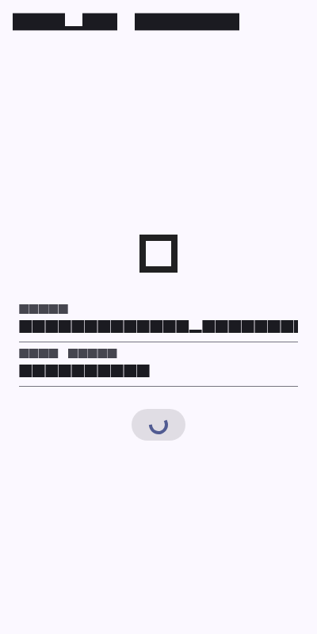
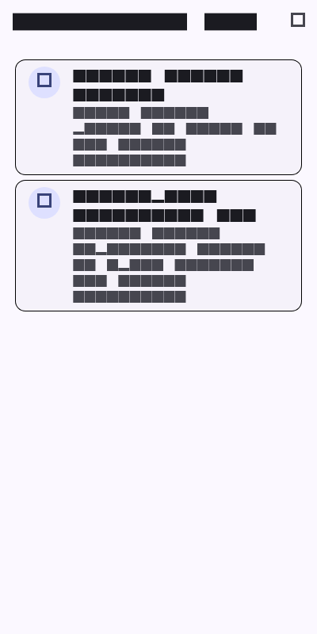

# Week 7: Feature-First Clean Architecture

Mobile Application Development Lab Assignment - Week 7 Architectural Refactoring: Implementing Feature-First Clean Architecture and SOLID Principles on `campus_notify`.

---

## Student Details
* **Name:** Tiara Febrianie
* **Student ID (NIM):** 244107020097
* **Class:** TI-3I
* **Department:** Information Technology - State Polytechnic of Malang (Polinema)

---

## Objectives
* Restructure monolithic Flutter project layers into modular, **Feature-First Clean Architecture**.
* Implement the five **SOLID principles** within mobile development:
  * **S (Single Responsibility):** Separate UI rendering, domain logic, data models, and external storage.
  * **O (Open/Closed):** Add new data sources (e.g., swapping mock repositories with real REST APIs) without modifying existing widgets.
  * **L (Liskov Substitution):** Ensure fake/mock test repositories substitute real implementations seamlessly.
  * **I (Interface Segregation):** Design targeted, feature-specific repository contracts instead of monolithic interfaces.
  * **D (Dependency Inversion):** Depend on domain abstractions rather than concrete driver implementations.
* Decouple the **Domain layer** from Flutter, UI frameworks, third-party libraries, and low-level data drivers.
* Enforce **inward-pointing dependencies**: `Presentation` and `Data` layers depend on `Domain`, while `Domain` knows nothing about either.
* Wire dependencies using **Riverpod** as a compile-time dependency injection container without external locator packages.
* Prove layer sterility through automated regex grep checks (zero raw data clients in presentation, zero UI/package imports in domain).
* Write deterministic domain unit tests using `FakeAnnouncementRepository` and records-based failure handling.

---

## Tech Stack
* **Framework:** Flutter 3.x
* **Language:** Dart 3.x
* **Architecture Pattern:** Feature-First Clean Architecture (`core/`, `features/announcements/`, `features/auth/`)
* **State Management & DI:** `flutter_riverpod: ^2.6.1`
* **Routing & Deep Linking:** `go_router: ^15.1.2`
* **Secure Storage:** `flutter_secure_storage: ^9.2.4`
* **Testing:** `flutter_test` (3 unit and use case tests passing)

---

## Architecture & Layer Diagram

Dependencies strictly point inward toward the core business domain:

```
┌────────────────────────────────────────────────────────┐
│                   PRESENTATION LAYER                   │
│   (Pages, Widgets, Riverpod StateNotifiers / Views)    │
└───────────────────────────┬────────────────────────────┘
                            │ Depends on (calls use cases & entities)
                            ▼
┌────────────────────────────────────────────────────────┐
│                      DOMAIN LAYER                      │
│        (Entities, Repository Contracts, Use Cases)     │
│       100% PURE DART - ZERO FLUTTER      │
└───────────────────────────▲────────────────────────────┘
                            │ Implements (Dependency Inversion)
┌───────────────────────────┴────────────────────────────┐
│                       DATA LAYER                       │
│    (Data Models, Repository Implementations, Drivers)  │
└────────────────────────────────────────────────────────┘
```

### Directory Structure:
```
lib/
├── core/
│   ├── failures.dart           # Failure hierarchy (LocalFailure, AuthFailure)
│   └── format.dart             # Pure helpers (formatDate, routeFromMessage)
├── features/
│   ├── announcements/
│   │   ├── data/
│   │   │   ├── models/         # AnnouncementModel (fromMap / toMap)
│   │   │   └── repositories/   # AnnouncementRepositoryImpl (mock seed)
│   │   ├── domain/
│   │   │   ├── entities/       # Pure Announcement entity
│   │   │   ├── repositories/   # AnnouncementRepository interface
│   │   │   └── usecases/       # GetAnnouncements, GetAnnouncement
│   │   └── presentation/
│   │       ├── pages/          # AnnouncementsPage, AnnouncementDetailPage
│   │       ├── providers/      # Riverpod DI wiring & async state
│   │       └── widgets/        # AnnouncementTile
│   └── auth/
│       ├── data/
│       │   ├── models/         # AuthSessionModel
│       │   └── repositories/   # AuthRepositoryImpl + Secure Storage
│       ├── domain/
│       │   ├── entities/       # Pure AuthSession entity
│       │   ├── repositories/   # AuthRepository interface
│       │   └── usecases/       # LoginUseCase
│       └── presentation/
│           ├── pages/          # LoginPage
│           └── providers/      # AuthNotifier & session check
├── routes.dart                 # Declarative GoRouter routing & guards
└── main.dart                   # Application bootstrap with ProviderScope
```

---

## Pembuktian Sterilitas Layer (Sterility Grep Proofs)

Untuk memastikan aturan arsitektur tidak dilanggar secara tidak sengaja, dilakukan dua verifikasi statis:

### 1. Presentation Sterility (Bebas dari driver data mentah / client HTTP / DB)
```bash
Get-ChildItem -Path 'lib\features\*\presentation' -Recurse -Filter '*.dart' | Select-String -Pattern 'Dio\(|openDatabase|getDatabasesPath|FlutterSecureStorage|SharedPreferences\.getInstance|jsonDecode'
```
**Hasil:** `0 hits` (LULUS - Tidak ada widget atau page yang memanggil driver data secara langsung).

### 2. Domain & Core Sterility (Bebas dari framework Flutter dan library eksternal)
```bash
Get-ChildItem -Path 'lib\features\*\domain', 'lib\core' -Recurse -Filter '*.dart' | Select-String -Pattern "import 'package:flutter|import 'package:dio|import 'package:sqflite|import 'package:firebase"
```
**Hasil:** `0 hits` (LULUS - Seluruh domain entities, interfaces, dan use cases 100% murni Dart).

---

## How to Run & Test

1. Navigate to the Week 7 project directory:
   ```bash
   cd 07-week-7-clean-architecture
   ```
2. Fetch dependencies:
   ```bash
   flutter pub get
   ```
3. Run static analysis:
   ```bash
   flutter analyze
   ```
4. Run automated unit tests:
   ```bash
   flutter test
   ```
5. Run application:
   ```bash
   flutter run
   ```

---

## AI Challenge & Refactoring Audit

Dokumentasi lengkap mengenai prompt challenge, analisis migrasi berkas, dan perbandingan usulan AI dengan keputusan arsitektur final tersimpan di [`docs/ai-verification.md`](docs/ai-verification.md).

### Ringkasan Keputusan:
1. **Memisahkan Interface dari Implementasi:** Menolak usulan AI yang menggabungkan kontrak repositori dan implementasinya dalam satu direktori. Kontrak abstrak ditempatkan di `domain/repositories/` agar lapisan presentasi dan pengujian tidak bergantung pada infrastruktur `data/`.
2. **Menolak Paket DI Tambahan:** Menolak usulan AI yang meminta instalasi `get_it` dan `injectable`. DI disederhanakan dengan memanfaatkan Riverpod provider wiring yang sudah terpasang.
3. **Mencegah Over-Engineering pada CRUD Pasif:** Hanya fitur yang membutuhkan aturan validasi atau alur autentikasi bertahap yang dibungkus dalam class `UseCase`. Operasi pembacaan pasif tetap terstruktur rapi tanpa membuat puluhan class use case kosong satu baris.

---

## Automated Testing Verification

Pengujian unit pada [`test/clean_architecture_test.dart`](test/clean_architecture_test.dart) menguji alur use case sukses dan gagal menggunakan `FakeAnnouncementRepository` independen:

```bash
flutter test
```

### Hasil Uji Otomatis (3/3 Passed):
- `GetAnnouncements returns entities from a fake repository`
- `GetAnnouncement returns a failure when the item is missing`
- `formatDate and routeFromMessage are pure helpers`

---

## Lab Reflections

### 1. Mengapa interface repository harus berada di domain, bukan di data? Apa yang rusak jika posisinya dibalik?

Dalam Clean Architecture, aturan ketergantungan (*Dependency Rule*) menyatakan bahwa panah dependensi kode hanya boleh mengarah ke dalam, yaitu menuju lapisan inti bisnis (*Domain*). 

Jika kontrak interface diletakkan di dalam folder `domain/repositories/`:
* Lapisan domain mendefinisikan kebutuhan bisnisnya sendiri secara murni, tanpa peduli apakah data nantinya diambil dari REST API Dio, SQLite, Firebase, atau sekadar memori sementara.
* Lapisan `data` berada di luar dan mengimplementasikan kontrak tersebut (*Dependency Inversion Principle*). Lapisan `presentation` cukup memanggil kontrak abstrak domain.

Sebaliknya, jika kontrak interface ditaruh di dalam folder `data/`:
* Lapisan `domain` terpaksa mengimpor folder `data` agar bisa mengenali interface repositori tersebut.
* Akibatnya, hierarki terbalik: aturan bisnis inti menjadi bergantung pada lapisan infrastruktur luar. Jika tim ingin mengganti library database atau menguji use case secara terisolasi, domain ikut terikat (*tight coupling*). Hal ini merusak portabilitas kode dan membuat unit test domain sulit dijalankan tanpa membawa dependensi data luar.

### 2. Kapan sebuah use case benar-benar dibutuhkan, dan kapan pemanggilan repository langsung ke notifier sudah cukup?

Sebuah **Use Case** (atau Interactor) benar-benar dibutuhkan ketika:
1. **Ada Logika Bisnis & Validasi:** Terdapat aturan bisnis spesifik sebelum atau sesudah data diambil, seperti memvalidasi format email, memeriksa saldo minimum, atau mengenkripsi payload.
2. **Orkestrasi Multi-Repository:** Alur kerja membutuhkan penggabungan data dari beberapa sumber sekaligus (misalnya: mengambil profil mahasiswa dari SQLite, mengambil jadwal kuliah dari REST API, lalu menggabungkannya menjadi satu model komposit).
3. **Pemberian Hak Akses & Sesi:** Mengatur transisi alur yang kompleks (misalnya proses login yang harus memanggil API, menyimpan token ke secure storage, dan mereset status cache).

Sebaliknya, pola **Repository langsung ke Notifier/StateProvider** sudah lebih dari cukup untuk operasi baca pasif (*simple 1-line CRUD / pass-through query*). Misalnya hanya memanggil `repository.getAnnouncements()` tanpa transformasi atau aturan bisnis tambahan. Memaksakan pembuatan class use case hanya untuk meneruskan satu baris kode panggilan repositori adalah bentuk *over-engineering* yang tidak memberikan nilai tambah dan hanya menambah boilerplate.

### 3. Apa kerugian over-engineering (membuat use case untuk setiap 1 baris CRUD) bagi tim kecil? Kapan biaya tersebut sepadan?

Bagi tim pengembang berskala kecil (1–4 developer) dengan waktu rilis yang ketat:
* **Beban Pemeliharaan & Boilerplate:** Setiap kali ada fitur kecil, developer harus membuat dan menyinkronkan 4–5 berkas sekaligus (`Entity`, `Model`, `Repository Interface`, `Repository Impl`, `UseCase`, dan `Provider`).
* **Kecepatan Pengembangan Melambat (*Cognitive Overhead*):** Developer harus berpindah-pindah tab berkas hanya untuk menelusuri alur pembacaan data sederhana. Ketika ada perubahan skema field, perubahan harus diulang di banyak tempat.
* **Biaya Refactoring Tinggi:** Jika spesifikasi produk masih sering berubah-ubah di awal (*frequent pivot*), arsitektur yang terlalu kaku memperlambat iterasi.

Biaya tersebut **sepadan (*worth it*)** ketika:
* Aplikasi sudah memasuki tahap produksi dengan puluhan pengembang yang bekerja paralel dalam tim-tim berbeda.
* Fitur memiliki aturan bisnis yang kritis (misalnya modul transaksi keuangan, validasi KRS akademik, atau sistem perbankan), di mana setiap use case wajib diuji unit test secara independen hingga 100% *code coverage* tanpa mempedulikan UI.

### 4. Bagian usulan AI mana yang Anda tolak atau sederhanakan, dan apa alasannya?

Ketika meninjau draf usulan yang diberikan oleh AI untuk refactoring Week 7:
1. **Menolak Pembuatan Use Case untuk Setiap Baris Kode:** AI mengusulkan pembuatan class use case untuk semua fungsi CRUD pasif (seperti `FetchAnnouncementDetailUseCase`, `GetThemeModeUseCase`, dll). Saya menyederhanakannya: hanya alur dengan logika bisnis (seperti `LoginUseCase`, `GetAnnouncements`) yang dipertahankan sebagai use case terpisah, sedangkan operasi pembacaan pasif langsung diakses dari notifier.
2. **Menolak Dependency Injection Menggunakan Paket Tambahan:** AI merekomendasikan penambahan library eksternal seperti `get_it` dan `injectable` lengkap dengan generator `build_runner`. Saya menolak ini karena aplikasi sudah menggunakan Riverpod. Riverpod sudah berfungsi sebagai DI container tingkat kompilasi yang sangat bersih, aman dari null-pointer, dan mudah di-override pada pengujian (`ProviderScope(overrides: [...])`).
3. **Memisahkan Model dari Entity Domain:** Draf awal AI menaruh method `fromJson()` dan `toJson()` langsung di dalam entity domain `Announcement`. Saya memisahkannya secara tegas: entity di `domain` tetap murni tanpa impor library eksternal, sedangkan serialisasi data dipindahkan ke `AnnouncementModel` di dalam `data/models/`.

---

## Screenshots

| Halaman Login (Clean Auth Presentation) | Daftar Pengumuman (Domain & Data Flow) | Detail Pengumuman (Clean Deep Link) |
|---|---|---|
|  |  |  |
