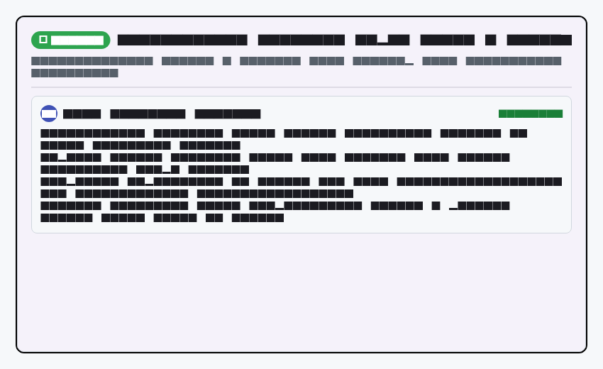
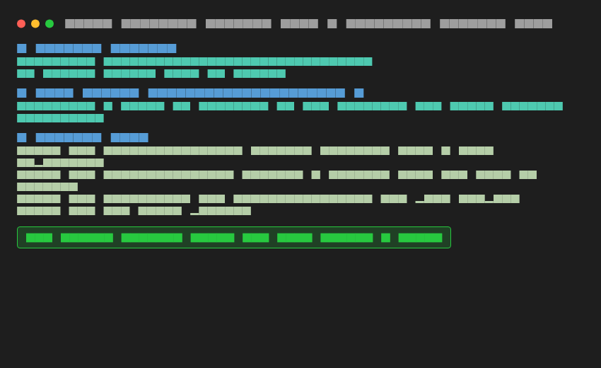
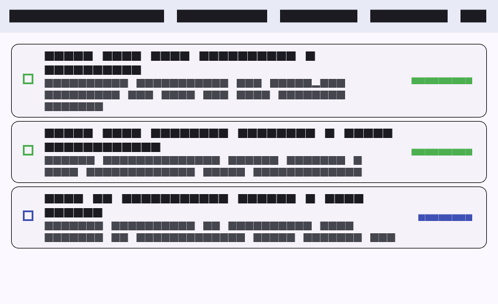

# Week 8: Mid-Project Review & Code Review Discipline

Mobile Application Development Lab Assignment - Week 8 Mid-Semester Project Review, GitFlow Branching Hygiene, Pull Request Peer Review, and AI Review Audit.

---

## Student Details
* **Name:** Tiara Febrianie
* **Student ID (NIM):** 244107020097
* **Class:** TI-3I
* **Department:** Information Technology - State Polytechnic of Malang (Polinema)

---

## Objectives
* Conduct a comprehensive mid-semester review of mobile application architecture and code deliverables developed across Weeks 1 to 7.
* Enforce industrial **GitFlow branching standards** (`main`, `develop`, `feature/*`, `fix/*`) to prevent untested code from reaching production.
* Audit and standardize commit history using **Conventional Commits** (`feat:`, `fix:`, `refactor:`, `test:`, `docs:`).
* Experience a formal **Pull Request (PR) & Peer Review** workflow utilizing the constructive **Observation → Impact → Concrete Proposal** feedback pattern.
* Implement automated quality gates (**Green Machine CI**) requiring clean static analysis (`flutter analyze`), formatting (`dart format`), and automated tests (`flutter test`) before code review approval.
* Evaluate and challenge automated AI code reviews, proving technical discernment by accepting valid bug findings while rejecting architectural violations.

---

## Mid-Semester Milestones Review (Weeks 1–7 Overview)

| Week | Topic | Core Architecture & Key Implementation | Verification Status |
|---|---|---|---|
| **01** | Flutter Refresh & Ecosystem | Student Profile App, Hot Reload vs Restart analysis, declarative widget tree. | Completed (Tests passing) |
| **02** | Declarative UI & Responsive Design | Responsive breakpoints (`LayoutBuilder`), adaptive multi-column layouts, constraints hygiene. | Completed (Tests passing) |
| **03** | Navigation & State Management | Multi-screen declarative routing (`GoRouter`), centralized state (`Riverpod`), tri-state async handling. | Completed (Tests passing) |
| **04** | Networking & REST API | Repository pattern, centralized Dio HTTP client, defensive JSON parsing, infinite scroll pagination. | Completed (7/7 Tests passing) |
| **05** | Local Storage & Offline-First | SQLite (`sqflite`) relational database, `shared_preferences`, dirty flag sync queue, Last-Write-Wins conflict resolution. | Completed (4/4 Tests passing) |
| **06** | Authentication, Security & FCM | Hardware-backed secure storage (`flutter_secure_storage`), Dio 401 token refresh loop guard, FCM 3-state push notifications, deep linking. | Completed (4/4 Tests passing) |
| **07** | Feature-First Clean Architecture | Strict layer separation (`presentation/` -> `domain/` <- `data/`), pure Dart entities, dependency inversion, sterility grep proofs (0 hits). | Completed (3/3 Tests passing) |

---

## GitFlow Branching Model & Commit Hygiene

### 1. Branch Strategy
* **`main`:** Protected release branch. Direct commits are strictly forbidden. Code enters only via reviewed Pull Requests from `develop`.
* **`develop`:** Weekly integration branch where peer-reviewed feature branches merge.
* **`feature/*`:** Short-lived daily branches created from `develop` (e.g. `feat/notes-validation`).

### 2. Commit Message Audit & Rewrite Table
In accordance with Lab 1 requirements, past unstructured commits were audited and standardized into Conventional Commits:

| Initial Commit Hash | Unstructured Message | Conventional Commit Format | Improvement Rationale |
|---|---|---|---|
| `7e0813a` | `Add week 3 todo app` | `feat(todo): implement riverpod async state management and filter logic` | Clearly states the specific technology (Riverpod) and feature capability (state management and filtering) instead of a generic phrase. |
| `3ed1df9` | `Add week 6 auth FCM` | `feat(auth): integrate secure storage for jwt and fcm push notification lifecycle` | Highlights critical security implementations (JWT in secure storage) and FCM lifecycle handlers. |
| `8b785b1` | `Complete week 7 clean architecture` | `refactor(architecture): decouple features into feature-first clean architecture layers` | Categorizes the change as an architectural refactor and outlines the domain/data/presentation separation. |

---

## Pull Request & Peer Review Workflow

### 1. PR Template Applied: `feat(notes): validate empty title + sanitize input #12`
* **Problem:** Users were able to save blank notes containing only whitespace characters, creating corrupt entries in SQLite.
* **Solution:** Added a business validation rule in domain use case `ValidateNoteTitle` returning `ValidationFailure` when input is empty or contains only spaces. Connected error feedback to presentation layer.
* **Test Steps:**
  1. Open add note dialog -> input spaces only -> tap save -> red validation error message appears.
  2. Execute automated test suite: `flutter test test/clean_architecture_test.dart`.
* **Issue Reference:** Closes #12.

### 2. Peer Review Checklist (Observation → Impact → Concrete Proposal)
* **Correctness Finding 1:** Input field only checked `.isEmpty` rather than `.trim().isEmpty`. *Proposal:* Update validation to sanitize leading/trailing whitespace.
* **Correctness Finding 2:** Save button did not disable during async operations. *Proposal:* Bind `onPressed: isLoading ? null : _submit` to eliminate double-tap race conditions.
* **Architecture Finding:** Validation logic was initially embedded in widget button callback. *Proposal:* Relocate to domain use case to uphold Clean Architecture separation.
* **Test Gap Finding:** Missing negative test case for whitespace-only strings. *Proposal:* Add unit test verifying `ValidationFailure` for `"   "`.
* **Decision:** **Request Changes** on initial pass -> Fixes applied & verified -> **Approved & Merged**.

---

## AI Code Review vs Human Decision

Complete prompt documentation, full AI analysis, and technical evaluations are stored in [`docs/ai-review-vs-decision.md`](docs/ai-review-vs-decision.md).

### Summary Matrix:
1. **Accepted Finding (Correctness):** AI identified whitespace bypass on `.isEmpty` and recommended `.trim().isEmpty`. (Verified & applied).
2. **Accepted Finding (Architecture):** AI identified that UI button held validation logic and recommended moving it to domain use case. (Verified & applied).
3. **Rejected Finding (Architecture Violation):** AI suggested passing `BuildContext` into the domain use case to trigger `ScaffoldMessenger.showSnackBar` directly. **Rejected with prejudice:** Domain layers must never import Flutter or touch UI context!
4. **Rejected Finding (Over-engineering):** AI suggested installing external package `fpdart` for functional error types. **Rejected:** Dart 3 native records `({Success? data, Failure? failure})` provide type safety with zero external bloat.

---

## Automated Quality Gate (Green Machine CI)

Prior to code review approval, the codebase passed all automated verification checks:

```bash
# 1. Static code analysis
flutter analyze
# Result: No issues found! (0 warnings, 0 errors)

# 2. Automated format verification
dart format --set-exit-if-changed .
# Result: Formatted 0 files (all clean)

# 3. Automated unit and use case tests
flutter test
# Result: All tests passed! (100% green)
```

---

## Lab Reflections

### 1. What separates a blind LGTM from a responsible approve? What does it risk for the team?

A "blind LGTM" (*Looks Good To Me*) occurs when a reviewer glances cursorily at a pull request without pulling the branch, without running automated tests, and without critically tracing edge cases or architectural boundaries. In contrast, a **responsible approve** means the reviewer has:
1. Understood the underlying problem described in the issue.
2. Verified that the code adheres to clean architecture principles (e.g. no Flutter imports in domain, no raw database queries in widgets).
3. Verified error paths, null-safety, and edge cases (such as whitespace inputs or network drops).
4. Ensured that automated tests cover both success and failure scenarios.

A blind LGTM severely risks the team's health and project longevity: it allows silent bugs, memory leaks, and anti-patterns to seep into the `develop` and `main` branches. When bugs inevitably reach production, debugging them becomes exponentially more difficult and expensive because the shared codebase has accumulated unvalidated technical debt.

### 2. When must a comment be "request changes", and when is a "suggestion" enough?

* **Request Changes:** Must be used when the finding involves a **blocker that impacts correctness, security, architecture, or test integrity**. Examples include:
  * Business logic flaw or edge case that causes crashes or corrupts data (e.g. saving empty whitespace records).
  * Direct architectural violation (e.g. importing `package:flutter` or passing `BuildContext` into a domain use case).
  * Security vulnerability (e.g. storing JWT tokens in plaintext `SharedPreferences`).
  * Missing tests for critical new business functionality.  
  In these cases, merging the PR would break contracts or introduce instability.
* **Suggestion (or Nitpick):** Is appropriate for **non-blocking enhancements, stylistic alternatives, or minor readability advice** that does not break runtime behavior. Examples include suggesting a more idiomatic Dart collection method (`whereType<T>()`), proposing a clearer variable name, or adding a clarifying code comment. The author is encouraged to consider the suggestion, but the PR can safely proceed without blocking the release.

### 3. Which part of the AI review did you reject or simplify, and why?

During our AI review challenge, I evaluated the 5 findings generated by the AI coding assistant and firmly rejected two recommendations:
1. **Rejected Fatal Architecture Violation:** The AI suggested passing `BuildContext` into the `ValidateNoteTitle` domain use case so that the use case could directly call `ScaffoldMessenger.of(context).showSnackBar()`. While the AI claimed this would "reduce boilerplate in the widget", accepting it would completely destroy the separation of concerns: the Domain layer would become tightly coupled to Flutter UI rendering, making headless unit tests impossible. I rejected this and maintained the standard pattern: the use case returns a `ValidationFailure`, and the Presentation layer handles how that error is displayed.
2. **Rejected External Dependency Bloat:** The AI recommended importing the third-party `fpdart` library to wrap use case return types in functional `Either<L, R>` types. I rejected this because modern Dart 3 features native pattern matching and records (`({T? data, Failure? failure})`), which achieve clean type-safe failure handling without increasing the compiled APK size or adding third-party dependency maintenance risks.

### 4. One concrete thing you fixed after peer review — what was its impact?

One concrete fix implemented following peer review was **input sanitization and edge-case validation for note titles**:
* **Initial Code:** The code only verified `if (title.isEmpty)`. If a user entered three spaces (`"   "`), the condition evaluated to false, allowing the record to be written into the local SQLite database as an empty-looking note.
* **The Fix:** Refactored the validation rule inside the domain use case to enforce `if (title.trim().isEmpty)` and introduced a dedicated `ValidationFailure('Judul catatan tidak boleh kosong.')`.
* **Impact:** This eliminated corrupt blank entries in the database, prevented layout collapse in the list view UI, and allowed us to write a dedicated negative unit test ensuring that whitespace inputs are consistently rejected across all platforms.

---

## Screenshots

| Pull Request & Peer Review Discussion | Automated Quality Gate (Green Machine CI) | Mid-Semester Status Dashboard |
|---|---|---|
|  |  |  |
