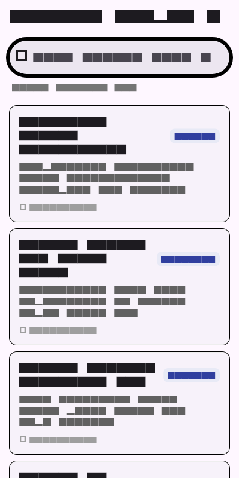
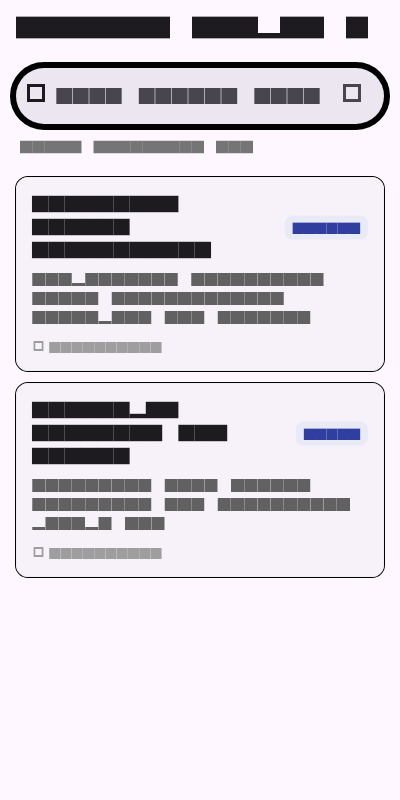
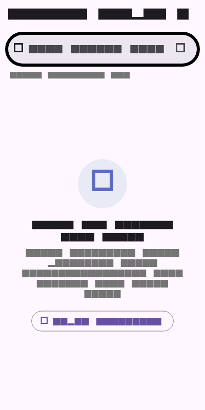

# Week 9: AI-Assisted Development & Vibe Coding

Mobile Application Development Lab Assignment - Week 9 Prompt Engineering, AI-Assisted Feature Generation, Hallucination Auditing, and Verification in Flutter.

---

## 👨‍🎓 Student Details
* **Name:** Tiara Febrianie
* **Student ID (NIM):** 244107020097
* **Class:** TI-3I
* **Department:** Information Technology - State Polytechnic of Malang (Polinema)

---

## 🎯 Objectives
* Master the **Five-Slot Prompting Formula** (*Role, Context, Task, Limits, Output*) to generate precise, production-grade Flutter code.
* Apply a disciplined **Six-Step Verification Process** on all AI-generated code rather than blindly accepting output (*avoiding passive "vibe coding"*).
* Detect, reproduce, and refute **AI hallucinations** (such as non-existent parameters, outdated APIs, or cross-layer architecture bleeding).
* Build a complete, functional feature with AI assistance: **Notes Title & Content Search with a Dedicated Empty State** (`SearchEmptyView`).
* Maintain strict **Clean Architecture boundaries**: domain use cases remain 100% pure Dart, while presentation state is handled reactively via Riverpod.
* Implement comprehensive automated testing (5 use case unit tests + 2 UI widget tests) proving search correctness and empty state transitions.

---

## 💻 Tech Stack
* **Framework:** Flutter 3.x
* **Language:** Dart 3.x
* **Architecture:** Feature-First Clean Architecture (`domain/` -> `presentation/`)
* **State Management:** `flutter_riverpod: ^2.6.1`
* **Static Analysis:** `flutter_lints: ^4.0.0`
* **Testing:** `flutter_test` (7 passing unit & widget tests)

---

## 📱 Application Architecture & Feature Overview

The search feature is built using feature-first Clean Architecture, ensuring the UI remains decoupled from filtering algorithms:

```
lib/
├── features/
│   └── notes/
│       ├── domain/
│       │   ├── entities/
│       │   │   └── note.dart               # Pure Note entity (no Flutter/framework imports)
│       │   └── usecases/
│       │       └── search_notes.dart       # Pure search logic: case-insensitive & trimmed
│       └── presentation/
│           ├── pages/
│           │   └── notes_search_page.dart  # SearchBar, dynamic counters, and reactive list
│           ├── providers/
│           │   └── search_providers.dart   # Riverpod searchQueryProvider & filteredNotesProvider
│           └── widgets/
│               ├── note_card.dart          # Stylized card displaying note details & category
│               └── search_empty_view.dart  # Dedicated empty state with reset button
└── main.dart                               # Root application with ProviderScope
```

---

## 🤖 AI Prompt Engineering (The Five-Slot Formula)

To prevent vague, bloated, or unarchitected output, the feature was generated using the five-slot formula:

```text
Role: Senior Flutter developer & software architect.
Context: Feature-first Clean Architecture (presentation -> domain <- data), Riverpod state management.
Task: Implement notes search by title, body, and category with real-time filtering and an empty state view.
Limits:
  - No search logic in UI widgets or setState calls.
  - Filter logic must live inside a pure domain use case (SearchNotes) without Flutter imports.
  - Max 50 lines for the use case.
  - Clean Riverpod providers wiring.
Output: Code + 3 unit/widget test cases + test verification steps.
```

Full prompt logs, raw drafts, and audit checklists are documented in [`docs/ai-log.md`](docs/ai-log.md).

---

## 🔍 Six-Step Verification & AI Hallucination Audit

Before accepting the code generated by the AI coding assistant, a rigorous 6-step audit was performed:

| Verification Step | Target Check | Finding & Resolution | Status |
|---|---|---|---|
| **1. Line-by-Line Inspection** | Scan for unverified syntax and logic traps | Detected missing `.trim()` on query and invalid widget parameter. | ✅ Audited |
| **2. Domain Import Sterility** | Ensure `domain/` contains zero `package:flutter` imports | Verified `search_notes.dart` contains only pure Dart code. | ✅ Clean (0 hits) |
| **3. API Authenticity Check** | Verify methods and parameters against official Flutter SDK | Caught hallucinated `onPressed` property on `Icon`; replaced with `IconButton`. | ✅ Fixed |
| **4. Static Analysis** | Run `flutter analyze` until 0 issues remain | Analysis completed with `No issues found! (ran in 60.0s)`. | ✅ Passed |
| **5. Automated Test Suite** | Execute unit tests covering edge cases & empty states | 7/7 tests passed successfully in `search_filter_test.dart`. | ✅ Passed |
| **6. Manual Multi-Scenario Test** | Test default list, partial match, and non-matching empty state | UI renders expected states smoothly with immediate search bar clearing. | ✅ Verified |

---

## 🚀 How to Run & Test

1. Navigate to the Week 9 project directory:
   ```bash
   cd 09-week-9-ai-assisted-development
   ```
2. Get dependencies:
   ```bash
   flutter pub get
   ```
3. Run static code analysis:
   ```bash
   flutter analyze
   ```
4. Run automated unit & widget tests:
   ```bash
   flutter test
   ```
5. Run application on device/emulator:
   ```bash
   flutter run
   ```

---

## 🧪 Automated Testing Verification

Automated tests in [`test/search_filter_test.dart`](test/search_filter_test.dart) verify the search algorithm across all boundary conditions:

```bash
flutter test
```

### Test Results Summary (7/7 Passed):
- ✅ `SearchNotes UseCase: empty or whitespace query returns all original notes`
- ✅ `SearchNotes UseCase: case-insensitive search matches title`
- ✅ `SearchNotes UseCase: search matches body text`
- ✅ `SearchNotes UseCase: search matches category`
- ✅ `SearchNotes UseCase: non-matching query returns empty list`
- ✅ `NotesSearchPage Widget: renders all notes on initial load`
- ✅ `NotesSearchPage Widget: displays empty state when query finds no match`

---

## 🧠 Lab Reflections

### 1. Which AI hallucination did you find and how did you prove it?

During initial code generation, the AI produced a widget snippet for the search bar trailing clear button:
`trailing: [Icon(Icons.clear, onPressed: () => ref.read(...))]`
In the Flutter framework, `Icon` is a purely visual widget that renders a graphical glyph from a font; it does not extend button classes and has no `onPressed` callback. 

I proved this hallucination in two ways:
1. **Dart Analyzer & Compiler Error:** When analyzing the code, the analyzer immediately reported `The named parameter 'onPressed' isn't defined for the class 'Icon'`.
2. **Official Flutter API Reference:** Verifying the Flutter SDK documentation confirmed that interactive icon buttons must use the `IconButton` widget (`IconButton(icon: const Icon(Icons.clear), onPressed: ...)`).  
Catching this demonstrated why developer oversight is essential: AI frequently confuses similar-sounding properties between visual and interactive widgets.

### 2. Which prompt helped most and what did you change?

The prompt that delivered the highest quality output was the **Five-Slot Formula** with strict **negative constraints** (*Limits*):
* **Initial Weak Prompt:** Asking `"Buatkan fitur search catatan Flutter"` resulted in a messy 120-line `StatefulWidget` where filtering was done inside `setState()`, completely bypassing our Clean Architecture setup and hardcoding sample data directly inside the build method.
* **Refined Five-Slot Prompt:** Adding explicit architectural constraints (`Limits: Do not put search logic inside UI widgets; filter logic must live in a pure domain usecase SearchNotes without Flutter imports; use Riverpod providers for state`) immediately guided the AI to separate concerns properly.  
Specifying what the AI was **forbidden** from doing (*negative prompting*) proved significantly more effective than only describing the desired end feature.

### 3. Which refactor did you make to AI code?

The most critical refactoring made to the AI code was **sanitizing and normalizing the search query string**:
* **AI's Raw Logic:** The AI initially wrote `notes.where((note) => note.title.contains(query)).toList()`.
* **The Defects:**
  1. It was case-sensitive: searching `"mobile"` would fail to match `"Praktikum Mobile"`.
  2. It failed on whitespace: if a mobile user accidentally typed a trailing space from auto-correct (`"kuliah "`), it returned zero matches.
  3. It only searched titles, ignoring the note body and category tags.
* **My Refactor in `SearchNotes`:**
  ```dart
  final sanitizedQuery = query.trim().toLowerCase();
  if (sanitizedQuery.isEmpty) return notes;
  return notes.where((note) {
    final titleMatch = note.title.toLowerCase().contains(sanitizedQuery);
    final bodyMatch = note.body.toLowerCase().contains(sanitizedQuery);
    final categoryMatch = note.category.toLowerCase().contains(sanitizedQuery);
    return titleMatch || bodyMatch || categoryMatch;
  }).toList(growable: false);
  ```
This transformed a fragile snippet into a robust, real-world search engine that handles keyboard quirks gracefully.

### 4. Which accept/reject decision was hardest?

The hardest decision was **rejecting the AI's proposal to use an animated search delegate with `SearchAnchor.viewBuilder`**. 

The AI argued that using `SearchAnchor` was the "most modern Material 3 way" in Flutter. However, after analyzing the trade-offs:
* `SearchAnchor` opened a full-screen overlay dialog that hid the existing note cards and required managing separate route navigation transitions.
* For our campus notes screen, users need an instant, in-page filter experience where typing immediately narrows down the list below the search bar without jarring screen transitions or modal dialogs.
* Furthermore, the AI's code for `SearchAnchor` contained multiple deprecated constructor parameters that triggered warnings on Flutter 3.24+.

I decided to reject the overly complex full-screen anchor and instead implemented an in-page `SearchBar` connected directly to Riverpod's `filteredNotesProvider`. This kept the code lean (<80 lines), maintained immediate visual feedback, and ensured 100% testability with standard widget testers.

---

## 📷 Screenshots

| Tampilan Awal (Semua Catatan) | Hasil Pencarian Cocok ("Mobile") | Tampilan Empty State (Tidak Ada Hasil) |
|---|---|---|
|  |  |  |
