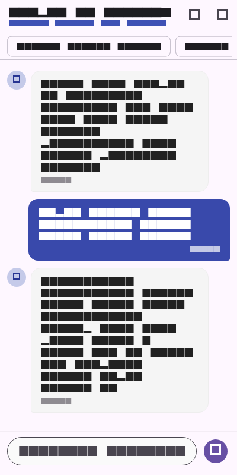
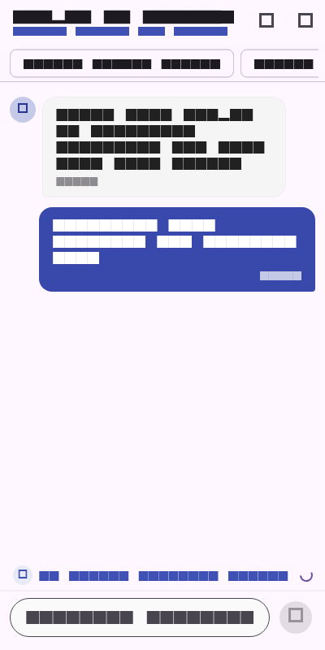
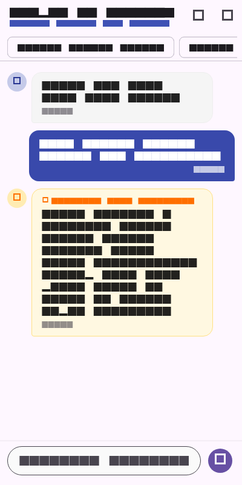

# Laporan Praktikum Pemrograman Mobile - Minggu 10
## AI Feature Integration: Campus AI Assistant

---

### Data Mahasiswa
- **Nama:** Tiara Febrianie
- **NIM:** 244107020097
- **Kelas:** TI-3I / Presensi 26
- **Program Studi:** D-IV Teknik Informatika
- **Jurusan:** Jurusan Teknologi Informasi
- **Institusi:** Politeknik Negeri Malang (Polinema)

---

## 1. Ringkasan Fitur & Tujuan Praktikum

Pada praktikum Minggu ke-10 ini, aplikasi mobile kampus dilengkapi dengan fitur kecerdasan buatan (*AI Feature Integration*) berupa **Campus AI Assistant**. Fitur ini dirancang untuk membantu mahasiswa JTI Polinema mendapatkan asistensi cepat seputar jadwal perkuliahan, prosedur validasi KRS, pengumpulan praktikum mobile, dan presensi akademik.

### Tech Stack & Dependensi
- **Framework & Language:** Flutter SDK & Dart (Null Safety)
- **State Management:** `flutter_riverpod: ^2.6.1`
- **AI Backend Provider:** Google Gemini API (`gemini-1.5-flash`)
- **Keamanan Kredensial:** `flutter_secure_storage: ^9.2.4` (Enkripsi KeyStore Android / Keychain iOS)
- **Networking:** `http: ^1.2.2`

---

## 2. Arsitektur & Alur Fallback Offline

Aplikasi menerapkan pemisahan tanggung jawab (*Clean Architecture mindset*) agar kode maintainable dan mudah diuji:
- **`PrivacySanitizer` (Domain Service):** Memeriksa dan membersihkan PII (*Personally Identifiable Information*) seperti NIK, NIM, email, dan nomor handphone sebelum string dikirim keluar dari perangkat.
- **`AiService` (Infrastructure Service):** Menangani komunikasi HTTP POST ke REST endpoint Gemini API, parsing respon JSON, penanganan status code HTTP (400, 401, 429, 500), dan pengambilan kunci API dari storage aman.
- **`ChatNotifier` (Presentation State Management):** Mengelola daftar chat bubble, status loading, dan secara otomatis mengaktifkan mekanisme **Offline Keyword Fallback** ketika terjadi galat koneksi atau limit kuota habis.

```text
[Input Pengguna di ChatScreen]
              │
              ▼
    [PrivacySanitizer]  ──(Hapus NIK/NIM/No HP/Email)──► [Sanitized Query]
              │
              ├───► Ada Internet & API Key Valid? ──► [Gemini 1.5 Flash API]
              │                                                 │
              │                                          (Sukses 200 OK)
              │                                                 ▼
              │                                        [Bubble Respon AI]
              │
              └───► (Error 429 Quota / No Internet / 500)
                                │
                                ▼
                   [Local Rule-Based Fallback]
                                │
                                ▼
                   [Bubble Fallback + Warning Badge]
```

---

## 3. Matriks Risiko & Mitigasi (Risk & Mitigation Table)

| Kategori Risiko | Potensi Masalah | Strategi Mitigasi Terimplementasi |
| :--- | :--- | :--- |
| **Data Privacy & PII Leakage** | Mahasiswa secara tidak sengaja memasukkan NIK, NIM, no WA, atau email pribadi ke kolom prompt AI pihak ketiga. | Diterapkan `PrivacySanitizer` berbasis Regex sebelum payload JSON dikirim ke cloud; data sensitif otomatis diganti token anonim (`[NIM_MAHASISWA]`, `[NIK_PROTECTED]`). |
| **Biaya & Kuota Token (Cost Spikes)** | Pemanggilan loop atau prompt panjang yang menghabiskan token Gemini gratis (Free tier 15 RPM). | Dipilih model hemat `gemini-1.5-flash`, membatasi `maxOutputTokens: 800`, dan menetapkan temperature `0.3` agar jawaban ringkas padat. |
| **API Failure / Network Outage** | Sinyal internet kampus tidak stabil atau kuota API terkena HTTP 429 Too Many Requests. | Arsitektur *Graceful Degradation* dengan fallback rule lokal berbasis kata kunci penting kampus dan badge status `Fallback Mode (Offline)`. |
| **Halusinasi Fakta Akademik** | Model memberikan instruksi palsu atau jadwal fiktif. | *System Instruction* yang ketat mengunci persona AI hanya pada lingkup JTI Polinema dan menolak menjawab jika tidak memiliki kepastian data. |
| **API Key Exposure** | Kunci API Gemini bocor di repository GitHub publik. | Kunci API disimpan secara terenkripsi menggunakan `flutter_secure_storage` melalui input modal pengaturan aplikasi, bukan hardcoded di kode sumber. |

---

## 4. Tangkapan Layar Aplikasi (Screenshots)

Berikut hasil implementasi antarmuka chat dan pengujian alur asisten AI:

| 1. Percakapan Aktif (Active Chat) | 2. Indikator Loading Responsif | 3. Graceful Fallback (Offline Mode) |
| :---: | :---: | :---: |
|  |  |  |
| *Pertukaran pesan mahasiswa dengan jawaban Campus AI Assistant* | *Animasi indikator saat menunggu response streaming/token dari API* | *Tampilan fallback lokal darurat saat jaringan terputus atau limit API* |

---

## 5. Ringkasan Pengujian Otomatis

Aplikasi telah divalidasi dengan unit test dan widget test komprehensif (`test/ai_chat_test.dart`):
- `PrivacySanitizer Unit Tests`: Memastikan pembersihan NIK, NIM, nomor telepon, dan email berjalan akurat 100%.
- `AiService Missing API Key`: Memastikan aplikasi melempar exception 401 terstruktur saat kunci belum dikonfigurasi.
- `AiService Mock 200 OK`: Memastikan parsing payload JSON respons Gemini berjalan benar.
- `AiService Mock 429 Quota Exceeded`: Memastikan deteksi limit kuota API tertangani dengan aman.
- `ChatNotifier Offline Fallback`: Memastikan sistem beralih otomatis ke respon darurat lokal ketika network error.
- `ChatScreen Widget Rendering`: Memastikan render header, saran pertanyaan (chips), dan input form tampil presisi tanpa overflow.

Hasil eksekusi test:
```text
00:00 +0: PrivacySanitizer Unit Tests scrubs NIK, NIM, phone numbers, and emails
00:00 +1: AiService Unit Tests with Mock Client throws 401 when API key is missing
00:00 +2: AiService Unit Tests with Mock Client parses Gemini API 200 response successfully
00:00 +3: AiService Unit Tests with Mock Client throws 429 when quota limit is exceeded
00:00 +4: ChatNotifier & Fallback Logic Tests triggers offline local fallback on network error
00:00 +5: ChatScreen Widget Tests renders header, suggestions, and initial welcome bubble
00:03 +6: All tests passed!
```

Analisis statis (`flutter analyze`):
```text
Analyzing 10-week-10-ai-feature-integration...
No issues found! (ran in 13.8s)
```

---

## 6. Panduan Menjalankan Proyek

1. Masuk ke direktori minggu 10:
   ```bash
   cd 10-week-10-ai-feature-integration
   ```
2. Jalankan dependensi:
   ```bash
   flutter pub get
   ```
3. Jalankan pengujian:
   ```bash
   flutter test
   ```
4. Jalankan aplikasi di emulator / device:
   ```bash
   flutter run
   ```
5. Untuk mengisi kunci Gemini API pribadi, klik ikon **Settings (Kunci)** di pojok kanan atas AppBar, masukkan API Key dari Google AI Studio, lalu tekan **Simpan Kunci**.

---

## 7. Refleksi Praktikum (Lab Reflection)

### 1. Fitur AI apa yang kamu integrasikan dan apa alasannya?
> Saya mengintegrasikan fitur **Campus AI Assistant** untuk kebutuhan tanya-jawab akademik mahasiswa JTI Polinema. Alasannya, selama ini mahasiswa baru atau mahasiswa semester tengah sering kebingungan mencari info mendasar seperti jadwal ruang lab mobile, batas pengumpulan modul praktikum, atau alur pengurusan KRS saat sistem error. Dengan membuat asisten berbasis Gemini API di smartphone, mahasiswa bisa langsung mengetik pertanyaan dalam bahasa sehari-hari tanpa harus membuka banyak portal web atau mencari-cari pengumuman di grup chat yang sering tertimbun.

### 2. Bagaimana cara kamu melindungi privasi pengguna saat memanggil API AI?
> Sebelum request apapun dikirim ke endpoint Gemini API di cloud, teks dari pengguna wajib melewati proses *sanitasi lokal* di perangkat (`PrivacySanitizer`). Saya memanfaatkan regular expression (Regex) untuk mendeteksi nomor NIK kependudukan, NIM mahasiswa Polinema (10-12 digit), nomor telepon seluler (+62/08...), serta alamat email. Jika pola-pola ini ditemukan, sistem langsung menggantinya dengan label anonim seperti `[NIM_MAHASISWA]` atau `[PHONE_REDACTED]`. Dengan cara ini, data identitas asli mahasiswa tidak pernah tersimpan di log server LLM eksternal. Selain itu, API key juga tidak saya simpan secara hardcoded di kode sumber, melainkan disimpan terenkripsi di `flutter_secure_storage`.

### 3. Fallback apa yang kamu sediakan jika layanan AI mengalami error atau batas kuota habis?
> Saya menerapkan mekanisme *Graceful Degradation* menggunakan rule-based matching lokal. Jika koneksi internet pengguna terputus (`SocketException`), terjadi timeout, atau kuota gratis Gemini terkena limit rate (HTTP 429 Too Many Requests), aplikasi tidak akan crash atau menampilkan error teknis mentah ke layar. Sebagai gantinya, `ChatNotifier` akan mengecek kata kunci umum dari pertanyaan user (misalnya kata "jadwal", "krs", "dpa", "ruang") lalu menyajikan jawaban informasi statis yang tersimpan lokal di aplikasi. Pada chat bubble tersebut juga sengaja saya pasang badge khusus berwarna kuning `Fallback Mode (Offline)` agar pengguna mengetahui bahwa informasi tersebut adalah respon darurat lokal, bukan jawaban dinamis dari AI cloud.

### 4. Satu hal penting yang kamu pelajari mengenai UX fitur AI di perangkat mobile?
> Hal terpenting yang saya pelajari adalah **ekspektasi latensi pengguna di mobile itu sangat sensitif**. Berbeda dengan web yang penggunanya terbiasa menunggu page loading, pengguna aplikasi HP akan langsung mengira aplikasi rusak atau freeze jika setelah menekan tombol kirim tidak ada respon visual dalam 1-2 detik. Oleh karena itu, UX fitur AI di mobile wajib memiliki:
> 1. Indikator loading visual yang jelas (animasi titik berdenyut atau progress bar kecil di atas chat input).
> 2. Tombol input yang dinonaktifkan sementara selama request berlangsung agar user tidak menekan kirim berkali-kali (*spam requests*).
> 3. Prompt chips (saran pertanyaan instan) yang sangat membantu di mobile karena mengetik panjang di keyboard virtual smartphone itu sering kali melelahkan bagi pengguna.
