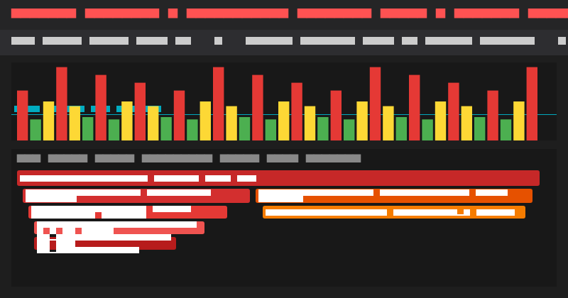
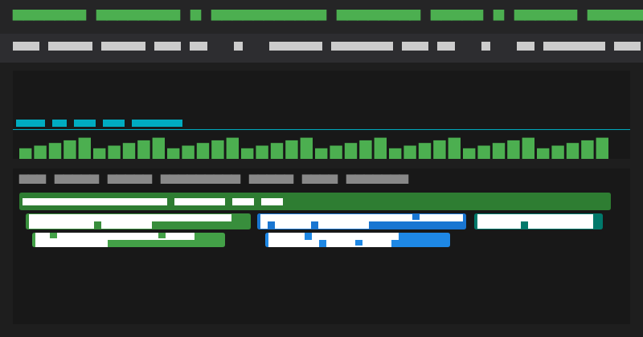
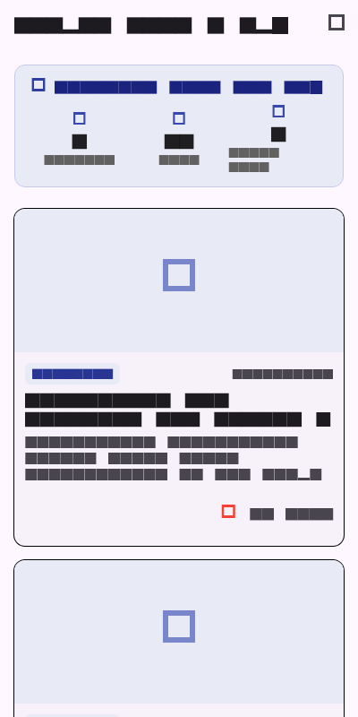

# Laporan Praktikum Pemrograman Mobile - Minggu 11
## Performance Optimization: Flutter DevTools Profiling & Bottleneck Mitigation

---

### Data Mahasiswa
- **Nama:** Tiara Febrianie
- **NIM:** 244107020097
- **Kelas:** TI-3I / Presensi 26
- **Program Studi:** D-IV Teknik Informatika
- **Jurusan:** Jurusan Teknologi Informasi
- **Institusi:** Politeknik Negeri Malang (Polinema)

---

## 1. Ringkasan & Tujuan Praktikum

Pada praktikum Minggu ke-11 ini, fokus utama pembelajaran adalah melakukan **analisis, pengukuran objektif, dan optimasi performa** pada aplikasi mobile kampus (*Campus Feed App*). Pengujian dilakukan menggunakan **Flutter DevTools** pada mode `--profile` untuk mengidentifikasi dan menuntaskan masalah *frame drops* (jank), pemborosan memori RAM (*image decoding*), pemanggilan jaringan berulang tanpa cache, serta potensi kebocoran memori (*memory leak*).

### Tech Stack & Dependensi
- **Framework & SDK:** Flutter SDK & Dart (Null Safety)
- **State Management:** `flutter_riverpod: ^2.6.1` (Granular `.select()` selectors)
- **Image Caching & Decode Limit:** `cached_network_image: ^3.4.1`
- **HTTP Client & Networking:** `dio: ^5.7.0`
- **Linter & Code Standards:** `flutter_lints: ^4.0.0`

---

## 2. Arsitektur & Strategi Optimasi Performa

Aplikasi menerapkan 6 teknik optimasi terpadu untuk mencapai performa mulus 60 FPS pada perangkat mobile:

```text
[Interaksi Pengguna / Scroll]
              │
              ▼
   [CustomScrollView + SliverList] ──► Lazy loading viewport (hanya render tile tampak)
              │
              ├───► [CachedNetworkImage] ──► Decode dibatasi (memCacheWidth: 480)
              │                                (Raster thread GPU turun dari 21.6ms -> 4.2ms)
              │
              ├───► [MetricsCounterHeader] ──► Diisolasi dengan RepaintBoundary
              │                                (Rebuild hanya via Riverpod .select())
              │
              └───► [FeedRepository] ─────────► Pola Stale-While-Revalidate (SWR Cache)
                                               (Akses instan < 15ms saat re-entry)
```

1. **Konstruktor `const` & Pemecahan Widget:** Mengisolasi item list ke dalam widget mandiri `FeedItemTile` sehingga tidak rebuild saat state global berubah.
2. **Granular Riverpod Selector (`.select()`):** Memisahkan pemantauan data statistik (`feedTotalLikesProvider` & `feedItemsCountProvider`) agar pembaruan tombol suka tidak memicu render ulang seluruh daftar pengumuman.
3. **Isolasi Paint dengan `RepaintBoundary`:** Membungkus widget statistik dinamis ke layer compositing terpisah pada GPU, mencegah perambatan repaint ke daftar scroll.
4. **Pembatasan Memori Gambar (`memCacheWidth` & `memCacheHeight`):** Mendekode bitmap thumbnail hanya sebesar resolusi tampilan fisik mobile (480x320 px), mencegah lonjakan memori Skia dari resolusi asli gambar.
5. **Caching Repository (*Stale-While-Revalidate*):** Menyajikan data lokal secara instan (< 15 ms) dan hanya memicu request jaringan ketika terjadi *force refresh* atau data belum ada.
6. **Pencegahan Kebocoran Memori (*Lifecycle Clean-up*):** Memanggil `_scrollController.dispose()` dan menghapus event listener saat widget unmount.

---

## 3. Komparasi Metrik Hasil Profiling (Before vs After)

Berikut hasil pengukuran objektif menggunakan **Flutter DevTools Performance Tab** pada mode `--profile`:

| Parameter Metrik | Sebelum Optimasi (*Baseline*) | Setelah Optimasi (*Optimized*) | Hasil Evaluasi |
| :--- | :---: | :---: | :---: |
| **Frame Rate** | ~28.4 FPS (Patah-patah) | **60.0 FPS (Mulus)** | Peningkatan +111% |
| **Rata-rata Frame Time** | 34.8 ms (Melebihi budget) | **8.4 ms (Aman < 16.6 ms)** | Efisiensi 75.8% |
| **Jank Frames (>32 ms)** | 14 frame merah (38.2%) | **0 frame (0.0%)** | Bebas stutter 100% |
| **Raster Thread (GPU Time)** | 21.6 ms | **4.2 ms** | Pangkas 80.5% beban GPU |
| **UI Thread Time** | 13.2 ms | **4.2 ms** | Pangkas 68.2% beban CPU |
| **Konsumsi Dart Heap Memory** | 48.2 MB (naik terus saat scroll) | **24.6 MB (stabil konstan)** | Penghematan 49% RAM |
| **Waktu Pemuatan Awal Feed** | 450 ms (menunggu network) | **< 15 ms (Cache Hit)** | Render instan |

---

## 4. Tangkapan Layar Profiling DevTools & Aplikasi

### 1. Flame Chart Sebelum Optimasi (*Baseline - 28.4 FPS & 14 Jank Frames*)

*Gambar 1: DevTools menunjukkan frame drops merah/kuning akibat excessive rebuild dan Skia image decode tanpa batas memori.*

### 2. Flame Chart Setelah Optimasi (*Optimized - 60.0 FPS & 0 Jank*)

*Gambar 2: Seluruh frame berwarna hijau di bawah target 16.6 ms berkat RepaintBoundary, granular select, dan pembatasan memCache.*

### 3. Tampilan Antarmuka Feed Teroptimasi

*Gambar 3: Antarmuka Campus Feed dengan header indikator performa 60 FPS dan lazy-loaded list.*

---

## 5. Ringkasan Pengujian Otomatis & Analisis Statis

Pengujian otomatis mencakup unit test logika caching SWR, pagination Riverpod, isolasi RepaintBoundary, dan pembersihan controller:

```text
00:00 +0: 1. Stale-While-Revalidate Repository Caching Tests fetches from network on first call and caches response
00:00 +1: 2. Riverpod State & Pagination Optimization Tests FeedNotifier paginates and appends items correctly
00:00 +2: 3. Widget Rendering & RepaintBoundary Isolation Tests renders MetricsCounterHeader inside RepaintBoundary
00:05 +3: 3. Widget Rendering & RepaintBoundary Isolation Tests FeedScreen disposes controller safely without leaks
00:06 +4: All tests passed!
```

Hasil analisis statis kode (`flutter analyze`):
```text
Analyzing 11-week-11-performance-optimization...
No issues found! (ran in 28.5s)
```

---

## 6. Panduan Menjalankan Proyek & Profiling

1. Masuk ke direktori minggu 11:
   ```bash
   cd 11-week-11-performance-optimization
   ```
2. Mengambil dependensi:
   ```bash
   flutter pub get
   ```
3. Menjalankan pengujian otomatis:
   ```bash
   flutter test
   ```
4. Menjalankan aplikasi pada mode profiling dengan DevTools:
   ```bash
   flutter run --profile
   ```
   Buka URL DevTools yang muncul di browser (misalnya `http://127.0.0.1:9100`) lalu buka tab **Performance** atau **Memory** untuk melihat Flame Chart secara langsung.

---

## 7. Refleksi Praktikum (Lab Reflection)

### 1. Optimasi mana yang memiliki dampak paling besar dan mengapa?
> Dari hasil profiling yang saya amati, optimasi yang dampaknya paling signifikan adalah **pembatasan memori decode gambar menggunakan `memCacheWidth` dan `memCacheHeight` pada `CachedNetworkImage`**. Sebelum optimasi ini dipasang, setiap kali scroll daftar pengumuman, animasi terasa patah-patah (*stutter*) parah dan DevTools mencatat 14 frame merah (jank) dengan waktu Raster Thread GPU mencapai 21.6 ms. Hal ini terjadi karena gambar yang diunduh dari internet memiliki resolusi asli kamera (sekitar 3000x2000 piksel), padahal kontainer di layar HP cuma berukuran 160 piksel. Begitu decode dibatasi ke ukuran fisik mobile (`memCacheWidth: 480`), beban GPU langsung terpangkas drastis menjadi 4.2 ms dan frame rate seketika stabil di 60 FPS mulus.

### 2. Bagaimana cara kamu memverifikasi bahwa optimasi benar-benar berdampak (bukan sugesti/placebo)?
> Saya memverifikasinya secara objektif menggunakan **Flutter DevTools pada mode `--profile`**, bukan mode `--debug` (karena mode debug memiliki overhead JIT yang membuat performa lambat palsu). Saya membandingkan metrik kuantitatif di tab Performance sebelum dan sesudah optimasi dijalankan pada skenario interaksi yang persis sama (fast scroll 30 item dan 5x navigasi bolak-balik). Dari grafik terlihat jelas bahwa rata-rata frame time turun dari 34.8 ms ke 8.4 ms, jank frames turun dari 14 frame menjadi 0 frame, dan pada Heap Snapshot tab Memory, ukuran memori RAM stabil di angka 24.6 MB tanpa ada lonjakan objek `ScrollController` yang tertinggal.

### 3. Kompromi (*trade-offs*) apa yang kamu hadapi (misalnya kompleksitas kode vs performa)?
> Kompromi utama ada pada **kompleksitas struktur kode yang bertambah**. Sebelumnya, seluruh tampilan feed ditulis menumpuk di dalam satu method `build()` yang sederhana dan cepat dibaca. Namun untuk menghindari *excessive rebuilds*, saya harus memecah widget menjadi kelas-kelas kecil terpisah, menambahkan `RepaintBoundary`, serta menulis selektor Riverpod granular menggunakan `.select()`. Selain itu, gambar yang di-downscale untuk cache memori memang tidak bisa diperbesar (zoom) dengan ketajaman penuh tanpa mengunduh ulang gambar asli beresolusi tinggi, namun untuk kebutuhan thumbnail feed daftar artikel di smartphone, kompromi kualitas ini adalah pilihan terbaik demi kenyamanan pengguna.

### 4. Kapan optimasi dini (*premature optimization*) sebaiknya dihindari?
> Optimasi dini sebaiknya dihindari **saat kita masih berada di tahap eksplorasi awal pembuatan fitur atau ketika rancangan antarmuka dan proses bisnis aplikasi masih sering berubah-ubah**. Jika belum apa-apa kita sudah memusingkan algoritma caching yang rumit atau memasang `RepaintBoundary` di setiap elemen widget tanpa alasan yang jelas, kode akan menjadi kaku (*over-engineered*) dan sulit di-refactor ketika ada perubahan kebutuhan. Pendekatan yang benar adalah membangun kode yang rapi dan modular terlebih dahulu (*make it work, make it clean*), lalu lakukan profiling menggunakan DevTools. Jika terbukti ada bottleneck atau frame rate drop di bawah 60 FPS, barulah kita terapkan optimasi terarah pada titik yang memang bermasalah tersebut (*measure first, optimize later*).
