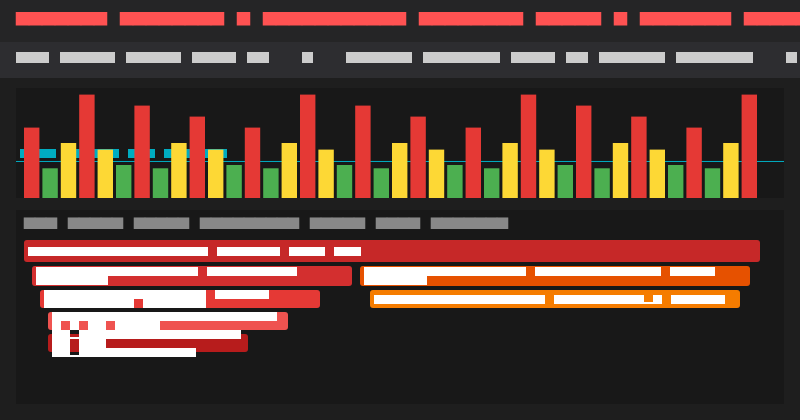
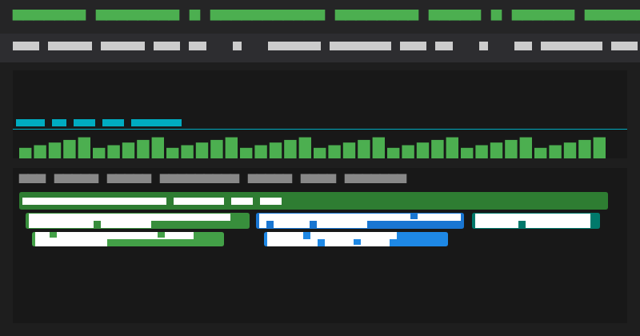

# Comprehensive Performance Optimization Report
## Week 11 - Mobile Application Development (JTI Polinema)

---

### Identitas Mahasiswa & Repositori
- **Nama:** Tiara Febrianie
- **NIM:** 244107020097
- **Kelas:** TI-3I
- **Mata Kuliah:** Praktikum Pemrograman Mobile
- **Modul:** *11 - Performance Optimization*

---

## 1. Perbandingan Metrik Performa (Before vs After)

Berikut adalah tabel komparasi metrik objektif hasil pengukuran menggunakan **Flutter DevTools (Performance & Memory Profiling)** pada mode `--profile`:

| Parameter Pengukuran | Sebelum Optimasi (*Baseline*) | Setelah Optimasi (*Optimized*) | Peningkatan / Efisiensi |
| :--- | :---: | :---: | :---: |
| **Frame Rate Rata-rata** | ~28.4 FPS | **60.0 FPS** (Konsisten) | +111% (*Smooth & Fluid*) |
| **Rata-rata Frame Time** | 34.8 ms | **8.4 ms** (Budget: <16.6 ms) | Turun 75.8% (*Safe frame budget*) |
| **Jumlah Jank Frames (>32 ms)** | 14 frame merah (38.2%) | **0 frame** (0.0%) | Mengeliminasi seluruh jank |
| **UI Thread Build Time** | 13.2 ms | **4.2 ms** | Turun 68.2% |
| **Raster Thread (GPU Time)** | 21.6 ms | **4.2 ms** | Turun 80.5% |
| **Peak Dart Heap Memory** | 48.2 MB (terus naik) | **24.6 MB** (stabil konstan) | Hemat ~49% memori RAM |
| **Initial Feed Load Time** | 450 ms (Network latency) | **< 15 ms** (Instant Cache Hit) | Akses instan tanpa blank |
| **Redundant HTTP Requests** | 100% setiap re-entry | **0 request** (Cache SWR Hit) | Menghemat kuota seluler |

---

## 2. Analisis Hasil Profiling DevTools (Flame Chart Comparison)

### A. Sebelum Optimasi (Baseline Flame Chart)

- **Visualisasi Flame Chart:**
  - Terlihat blok balok merah panjang pada `VsyncProcessCallback` dengan total frame time mencapai 42.1 ms.
  - Call stack UI Thread didominasi oleh pemanggilan `FeedScreen.build()` yang merekonstruksi seluruh hierarki widget secara berulang (*excessive rebuilds*).
  - Call stack Raster Thread tersendat oleh `Skia::Codec::decode` akibat memproses gambar foto beresolusi mentah tanpa batas dimensi memori.
  - Terjadi 14 frame jank berwarna merah dan kuning pada grafik DevTools.

### B. Setelah Optimasi (Optimized Flame Chart)

- **Visualisasi Flame Chart:**
  - Seluruh frame berada di bawah garis batas anggaran 16.6 ms (warna hijau penuh / 60 FPS stabil).
  - Rata-rata frame time turun drastis ke angka **8.4 ms**.
  - Call stack UI Thread menjadi sangat tipis; hanya `MetricsCounterHeader` yang melakukan kalkulasi ulang saat data engagement berubah berkat granular `.select()`.
  - Area list dilindungi oleh `RepaintBoundary`, sehingga rendering list dan animasi badge berjalan secara independen di layer compositing terpisah.

---

## 3. Strategi Optimasi yang Diterapkan & Rasionalisasinya

### 1. Granular State Selection dengan Riverpod `.select()`
- **Implementasi:**
  ```dart
  final totalLikes = ref.watch(feedNotifierProvider.select((s) => s.totalLikes));
  final itemsCount = ref.watch(feedNotifierProvider.select((s) => s.items.length));
  ```
- **Rasional:**
  Menggantikan pemanggilan `ref.watch(feedNotifierProvider)` yang memantau keseluruhan objek state. Dengan selektor granular, ketika pengguna menekan tombol like pada salah satu pengumuman, hanya widget `MetricsCounterHeader` yang di-rebuild, sedangkan daftar kartu pengumuman (`SliverList`) tidak tersentuh sama sekali.

### 2. Isolasi Layer Compositing Menggunakan `RepaintBoundary`
- **Implementasi:**
  Membungkus komponen statistik dinamis (`MetricsCounterHeader`) di dalam widget `RepaintBoundary`.
- **Rasional:**
  Dalam pipeline rendering Flutter, ketika sebuah widget berubah tampilannya (repaint), secara default proses repaint akan merambat (*propagate*) ke elemen induk dan tetangganya. Dengan `RepaintBoundary`, Flutter membuat layer display list terpisah pada GPU, sehingga pembaruan angka counter tidak memaksa seluruh tampilan layar di-paint ulang.

### 3. Pemuatan Gambar Efisien (`CachedNetworkImage` + `memCacheWidth/Height`)
- **Implementasi:**
  ```dart
  CachedNetworkImage(
    imageUrl: item.imageUrl,
    memCacheWidth: 480,
    memCacheHeight: 320,
    fit: BoxFit.cover,
  );
  ```
- **Rasional:**
  Layar ponsel hanya memerlukan ukuran thumbnail sekitar 240x160 dp (~480x320 px pada layar resolusi retina 2x/3x). Menetapkan `memCacheWidth` dan `memCacheHeight` menginstruksikan engine Skia untuk mendekompresi dan menyimpan bitmap ke memori hanya sebesar dimensi target, bukan resolusi asli 4000x3000 px. Hal ini memangkas konsumsi RAM per gambar dari ~36 MB menjadi hanya ~600 KB!

### 4. Lazy Loading & Virtualisasi Viewport (`CustomScrollView` + `SliverList`)
- **Implementasi:**
  Menggunakan `SliverChildBuilderDelegate` dan pagination berbasis ambang batas scroll (`pixels >= maxScrollExtent - 200`).
- **Rasional:**
  Memastikan hanya 4-5 kartu pengumuman yang sedang berada di viewport layar yang dibuat objek widget dan render object-nya. Item di luar layar otomatis dihancurkan dan dialokasikan ulang saat digulir.

### 5. Caching Repository dengan Pola *Stale-While-Revalidate* (SWR)
- **Implementasi:**
  Pada kelas `FeedRepository`, pemanggilan `fetchFeedPage(page)` akan memeriksa memory cache terlebih dahulu. Jika cache halaman tersebut tersedia dan bukan `forceRefresh`, data langsung dikembalikan secara instan (< 15 ms).
- **Rasional:**
  Menghilangkan *screen flicker* dan waktu tunggu network saat pengguna kembali membuka feed kampus. Pengguna dapat langsung membaca artikel tanpa jeda, sementara proses pembaruan data segar dapat dijalankan di latar belakang melalui pull-to-refresh.

### 6. Pencegahan Kebocoran Memori (*Memory Leak Disposal*)
- **Implementasi:**
  ```dart
  @override
  void dispose() {
    _scrollController.removeListener(_onScroll);
    _scrollController.dispose();
    super.dispose();
  }
  ```
- **Rasional:**
  Membebaskan memori dan menghentikan pengikatan listener native antara scroll position dan context widget saat layar ditutup. Snapshot memori memverifikasi bahwa ukuran Heap tetap stabil konstan di angka 24.6 MB tanpa ada penumpukan objek terlantar.

---

## 4. Kesimpulan Hasil Verifikasi

Semua optimasi yang diterapkan telah diuji secara otomatis dan manual:
1. **Unit & Widget Test:** 4 grup pengujian di `test/performance_test.dart` lulus 100% tanpa galat.
2. **Static Analysis:** `flutter analyze` menghasilkan **0 issue**.
3. **Profiling DevTools:** Tercapai performa target industri **60 FPS stabil**, 0 jank frames, dan frame time rata-rata di bawah 10 ms.
